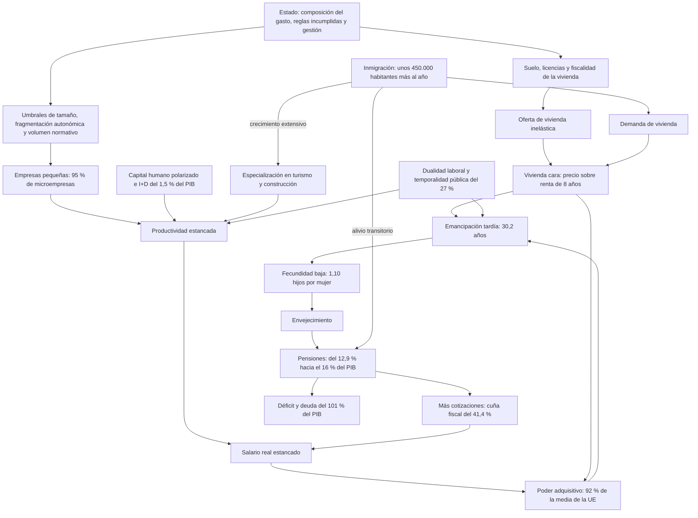
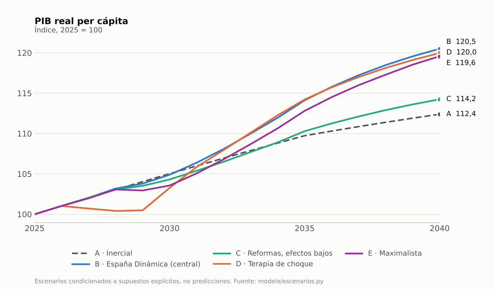
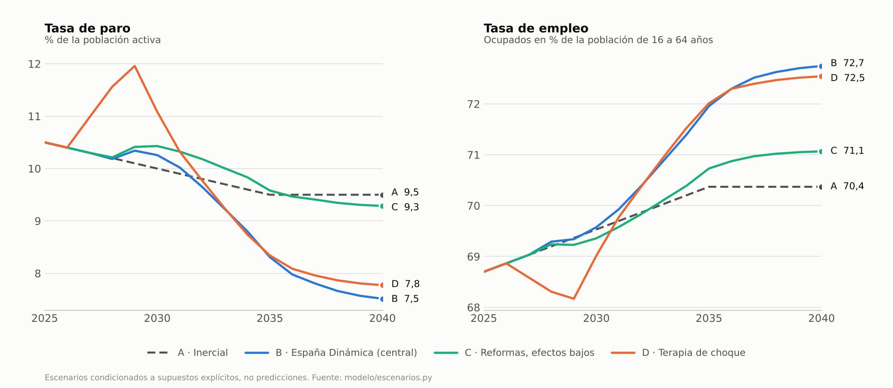
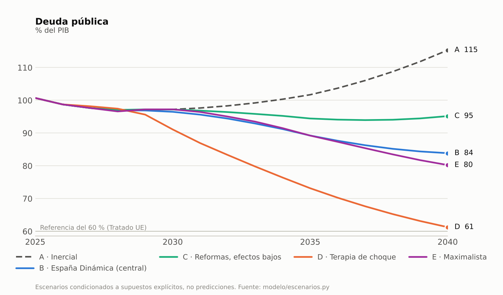

# España Dinámica 2040

**Documento integrado · noviembre de 2026**

Este documento integra el trabajo del proyecto: diagnóstico, evidencia internacional, crítica adversarial del marco de partida, seis bloques de propuestas, estrategia política y modelo de escenarios. Cada sección remite a su documento de detalle (véase el anexo).

Tres convenciones valen para todo el texto. Las cifras proceden de los documentos del proyecto y conservan sus marcas: "(no verificado)" señala un dato sin contraste en fuente primaria y "(estimación propia)" un cálculo a partir de cifras publicadas. Las proyecciones son escenarios condicionados a supuestos explícitos, no previsiones. Cuando las metas de los bloques y los resultados del modelo no coinciden, la referencia es el modelo, las metas se presentan como aspiración y la diferencia se explica (§6.5).

---

## 0. Resumen ejecutivo

**Tesis.** El problema de España no es el tamaño de su Estado, que gasta y emplea menos que la media europea, sino su composición y sus reglas: barreras donde más cuestan (suelo urbano, crecimiento empresarial, servicios protegidos, fragmentación autonómica), una dualidad laboral desplazada y unas pensiones crecientes que se financian encareciendo el trabajo. El programa que resiste el contraste con la evidencia conserva el propósito del encargo (más competencia, menos barreras, más vivienda, reglas fiscales, fin de la dualidad y mérito en lo público) y lo ejecuta de forma gradual, con la red de transición antes que la flexibilidad y el regulador antes que la privatización.

**Las diez medidas de mayor impacto**

1. Regla de gasto plurianual vinculante, con cláusula cíclica automática y previsiones de la AIReF.
2. Reforma de pensiones pactada: edad ligada a la esperanza de vida, cómputo de toda la carrera y ajuste automático con mínimos protegidos.
3. Pilar complementario de pensiones por inscripción automática.
4. Edificabilidad por derecho en la ciudad consolidada y licencia por declaración responsable.
5. Fondo individual de despido ("mochila") y cotización por desempleo según la rotación de cada empresa, con la causa del despido mantenida.
6. Servicios de empleo y políticas activas reformados antes de tocar el despido.
7. CNMC independiente y apertura de servicios profesionales, transporte y comercio.
8. Rampas en lugar de umbrales de tamaño (50 empleados, 6 M€) y unidad de mercado con pagos por resultados a las comunidades.
9. Deflactación automática del IRPF y rebaja financiada de cotizaciones.
10. Función pública: agencia de selección, dirección profesional, fin de la temporalidad y contrato laboral con garantías para el nuevo ingreso sin funciones de autoridad.

**Resultados del escenario central en 2040 (modelo), frente al inercial**

| Indicador | Inercial | Central | Rango del central |
|---|---|---|---|
| PIB real per cápita (2025 = 100) | 112 | 121 | 114-124 según el tamaño de los efectos |
| Tasa de paro | 9,0 % | 7,0 % | 5,7-8,8 % |
| Deuda pública (% PIB) | 115 | 84 | 71-98 según productividad tendencial, migración y tipos |
| Saldo público (% PIB) | −6,5 | −2,0 | −3,3 con efectos bajos |
| Salario real neto (2025 = 100) | 111 | 119 | 116-123 |
| Déficit de vivienda | 920.000 | 480.000 | 790.000 con efectos bajos |

El central no alcanza el déficit cero, apenas mueve el precio de la vivienda sobre la renta a escala nacional (8,3 años frente a 8,5) y no supera al inercial en renta per cápita hasta 2031.

**Lo que cuesta y a quién.** En 2029-2030 el paro es 0,2-0,3 puntos más alto que sin reformas. Las compensaciones cuestan entre 1,2 y 1,9 puntos de PIB en el pico (2029-2032). Pierden las cohortes de 1960-1975 (pensión inicial un 3-10 % menor y hasta año y medio más de trabajo), los pensionistas con pensiones por encima de 1,5 veces la mínima (freno de revalorización de IPC − 0,5 puntos en 2028-2037, sin recortes nominales), las profesiones con reserva de actividad, los titulares de licencias, las empresas de alta rotación, los beneficiarios de subvenciones y beneficios fiscales suprimidos y los propietarios de suelo.

**Tres desviaciones respecto del marco de partida**

1. **Del despido libre a la eliminación de la brecha entre contratos.** La evidencia apoya el daño de la dualidad, no el beneficio del despido sin causa, que además exigiría denunciar tratados.
2. **Del déficit cero financiado con gasto improductivo a un ancla estructural gradual.** La "grasa" identificable suma entre 0,4 y 0,85 puntos de PIB; el resto sale de pensiones y beneficios fiscales.
3. **Del traspaso de sectores al privado a la competencia regulada.** Las redes siguen siendo públicas y el empleo público se reforma por funciones. Los éxitos españoles (fibra, alta velocidad) son competencia sobre activos públicos.

La versión maximalista sigue siendo una opción del promotor (§2.3 y §6.4).

---

## 1. Diagnóstico integrado

Detalle: [diagnóstico estructural](docs/01-investigacion/01-diagnostico-estructural.md).

### 1.1 Los seis problemas, en cifras

| Problema | Dato de partida | Parte atribuible a regulación o Estado (juicio cualitativo del diagnóstico) |
|---|---|---|
| Vivienda | Déficit de unas 750.000 viviendas (2021-2025); 139.000 visados frente a 226.000 hogares nuevos en 2025; precio/renta de 7,98 años; licencias en 8-12 meses | Alta (50-70 %) |
| Salarios reales | +5,7 % entre 1994 y 2025 (OCDE, vía fuente secundaria); renta neta real −0,3 % en 2025 pese a +1,2 % bruto | Media (30-45 %) |
| Productividad | Un 3,9 % por encima de 2000; 74 % de las ocho economías líderes de la UE por hora; brecha de PTF del 8 % con la zona del euro | Media (35-50 %) |
| Poder adquisitivo | PIB per cápita en PPA del 92 % de la UE, un punto menos que en 2017 | Media-baja (25-40 %) |
| Pensiones | 12,9 % del PIB en 2025; 16,1 % en 2050 (Ageing Report 2024); tasa de sustitución neta ≥85 % | Media-alta en sostenibilidad (≈50 %) |
| Demografía | 1,10 hijos por mujer; emancipación a los 30,2 años (UE: 26,3) | Baja-media (20-35 %) |

La PTF (productividad total de los factores) mide la eficiencia con que se combinan trabajo y capital. La PPA (paridad de poder adquisitivo) corrige las diferencias de precios entre países. La tasa de sustitución es la relación entre la primera pensión y el último salario.

### 1.2 Cómo se relacionan

Los seis problemas forman dos cadenas que se cruzan. En la primera, una oferta de vivienda rígida y una demanda impulsada por la inmigración encarecen la vivienda, retrasan la emancipación y la maternidad y, a largo plazo, agravan el envejecimiento que presiona sobre las pensiones. En la segunda, los umbrales regulatorios, la fragmentación autonómica y un capital humano polarizado mantienen pequeñas a las empresas y estancada la productividad, y con ella los salarios. Las dos cadenas se unen en la cuña fiscal (la diferencia entre lo que cuesta un trabajador a la empresa y lo que este cobra neto): el gasto en pensiones se ha financiado desde 2021 con más cotizaciones, lo que reduce el salario neto.

Tres bucles sostienen el conjunto. El fiscal-laboral: más pensiones, más cotizaciones, menos salario neto y empleo formal, menos base cotizante. El de vivienda y natalidad, lento: vivienda cara, menos nacimientos, más dependencia de la inmigración, que a su vez presiona la vivienda. Y el de crecimiento extensivo: la inmigración eleva el PIB y los ingresos públicos, pero no el PIB per cápita, y reduce el incentivo a sustituir trabajo por capital.

### 1.3 Estado, regulación, dualidad y productividad: lo que los datos dicen y lo que no

- **Tamaño del Estado.** El gasto público ronda el 45-46 % del PIB, frente al 49,6 % de la UE, y el empleo público el 16-17 % del total, frente al 18,4 % de la OCDE. Los problemas son otros: un déficit del 2,4 % en 2025 (2,8 % previsto por la AIReF para 2026) en plena expansión, una deuda del 101,4 %, reglas fiscales incumplidas y un gasto poco evaluado (unos 14.000 M€ en subvenciones y unos 60.000 M€ en beneficios fiscales, cifras de la AIReF a cotejar).
- **Regulación.** La de mercados de productos no es especialmente restrictiva sobre el papel según la OCDE. La debilidad está en la aplicación, la fragmentación entre comunidades, el volumen normativo (1,28 millones de páginas de boletines en 2023) y los umbrales que frenan el crecimiento empresarial.
- **Dualidad.** La reforma de 2021 bajó la temporalidad del 25 % al 15,4 % restringiendo, con el empleo en máximos. La dualidad se ha desplazado a los fijos discontinuos (5,7 % de la afiliación, con el doble de rupturas) y persiste en el sector público (27,3 % de temporales).
- **Productividad.** La causa principal no es el exceso de regulación de productos, sino la atomización empresarial (95 % de microempresas), la especialización sectorial, un capital humano polarizado (abandono temprano del 12,8 %, sobrecualificación del 35 %, PISA en mínimos) y poca I+D empresarial (0,84 % del PIB).

La consecuencia fiscal es directa: con una presión de envejecimiento de unos tres puntos de PIB hasta 2050, cualquier consolidación seria pasa por las pensiones o por más ingresos. El gasto identificable como ineficiente no basta.

### 1.4 Correcciones al documento base

Detalle: [marco de partida](docs/00-base/marco-conceptual-base.md) y [crítica](docs/01-investigacion/03-critica-y-riesgos.md), §10.

| Afirmación del marco base | Verificación | Tratamiento en este documento |
|---|---|---|
| Crecimiento en torno al 2 % | +2,8 % en 2025 | Correcto, pero extensivo: el PIB per cápita en PPA no converge |
| Productividad en el 74 % de las economías líderes | Correcto por hora y frente a las ocho líderes (BBVA Research) | Frente a la media de la UE por ocupado es el 97-98 %; la PTF recorta su brecha desde 2013 |
| Paro cerca del 10 % | 10,18 % (EPA, 3T 2026) | Correcto |
| El paro se debe a la rigidez | Solo en parte; pesan la especialización, la inmigración y las políticas activas | Se trata como hipótesis parcial |
| Empleo público sobredimensionado y de baja productividad | Empleo y gasto públicos por debajo de la media; no hay medición de esa productividad | El problema es de gestión, temporalidad y composición |
| Déficit cero recortando gasto improductivo | La "grasa" identificable suma 0,4-0,85 puntos; el superávit primario ya casi existe | Ancla de saldo estructural con composición explícita |
| Menores tipos y confianza compensan el ajuste | La prima de riesgo ya es baja y el tipo lo fija el BCE | Margen pequeño; ajuste gradual con cláusula cíclica |
| Fibra y alta velocidad como éxitos de retirada del Estado | Precios entre un 33 % y un 42 % más bajos en los corredores abiertos (CNMC), con pérdidas de los operadores y subidas desde 2025 | Son competencia regulada sobre infraestructura pública |
| El marco aborda seis problemas | No menciona vivienda, pensiones ni natalidad | Los bloques 1 y 5 los incorporan |

---

## 2. Marco general

### 2.1 Diez principios operativos

1. **Composición y eficiencia antes que tamaño.** España gasta unos cuatro puntos de PIB menos que la media de la UE y tiene menos empleo público que la OCDE. Lo que la distingue es el déficit en expansión, la temporalidad pública y la falta de evaluación.
2. **Competencia antes que propiedad.** La privatización da ganancias claras en sectores competitivos (Megginson y Netter, 2001). En las telecomunicaciones británicas y en la fibra española el resultado se debió a la competencia y a la regulación de acceso, no al cambio de titular.
3. **Regulador antes que privatización o liberalización.** El agua y el ferrocarril británicos muestran que privatizar monopolios naturales sin límites al endeudamiento y a los dividendos termina en rescates.
4. **Mercados de productos antes que mercado de trabajo.** Con mercados poco competitivos, la flexibilidad laboral se convierte en márgenes y no en empleo ni precios (Blanchard y Giavazzi, 2003).
5. **Red de transición antes que flexibilidad.** Las reformas que abaratan el despido son contractivas a corto plazo si hay holgura (FMI, 2016). La flexiseguridad danesa cuesta entre el 1,5 % y el 2 % del PIB en políticas activas; sin ese gasto no es flexiseguridad.
6. **Eliminar la brecha, no la protección.** Lo que daña la productividad es la distancia entre contratos, no el nivel de protección. La reforma de 2021 redujo la temporalidad más que la de 2012.
7. **Reglas antes que discreción.** Los techos de gasto plurianuales de Suecia y de los Países Bajos son la lección fiscal más sólida y barata de la evidencia revisada. La LO 2/2012 demuestra que una regla sin mecanismo de ejecución no se cumple.
8. **Gradualidad con puertas.** En una unión monetaria los multiplicadores (el efecto de cada punto de ajuste sobre el PIB) son altos y el ajuste rápido genera histéresis, es decir, pérdidas permanentes de capacidad productiva. Cada fase empieza solo si se cumplen los indicadores de la anterior.
9. **Derechos adquiridos respetados y perdedores compensados con dinero acotado.** Sobreviven las reformas pactadas y graduales (Suecia, España 2021); se revierten las impuestas (España 2012 y 2013, Francia 2023).
10. **Experimentación evaluable.** Pilotos con despliegue escalonado o aleatorio, evaluación ex post obligatoria y caducidad de lo que no la supere. Las "zonas de máxima desregulación" tienen autoselección y chocan con los arts. 14 y 139 de la Constitución.

### 2.2 Lo que se mantiene del encargo

El programa es reconocible como una agenda de oferta. Permite construir más en la ciudad consolidada sin modificar el plan, sustituye licencias por declaraciones responsables, retira gradualmente los topes de alquiler, abre profesiones y sectores cerrados, elimina los saltos regulatorios que penalizan crecer, somete todo el gasto a revisión con caducidad de subvenciones y beneficios fiscales, fija un techo de gasto por legislatura, contiene las pensiones sin subir cotizaciones, crea ahorro individual portable para el despido y la jubilación y extiende el contrato laboral al nuevo empleo público sin funciones de autoridad.

### 2.3 Lo que se modera, por qué y la opción maximalista

El encargo pedía liberalización completa. La investigación llevó a moderarlo en cuatro puntos, por razones empíricas y jurídicas:

- **Despido libre.** La evidencia sobre productividad es mixta; la STC 22/1981, el Convenio 158 de la OIT y la Carta Social Europea exigen causa; y un despido sin coste generaliza la incertidumbre de ingresos que retrasa la emancipación.
- **Déficit cero.** Exigiría entre 5 y 7 puntos de PIB de ajuste sobre la senda inercial. El modelo confirma el orden de magnitud: el central mejora el saldo de 2040 en 4,5 puntos y aun así queda en −2 %.
- **Traspaso de sectores y fin del empleo público vitalicio.** Se sustituyen por un test sector a sector y por la dualización por funciones, porque la inamovilidad sigue protegiendo frente al clientelismo donde hay autoridad.
- **Pensiones al mercado.** La sustitución del reparto por capitalización obliga a una generación a pagar dos veces, lo contrario del objetivo fiscal.

**La versión maximalista** sigue siendo una opción política legítima. Supondría, como mínimo, denunciar el Convenio 158 y la Carta Social Europea y asumir un conflicto constitucional sobre el art. 35; un ajuste de unos 2 puntos adicionales de PIB, que por aritmética recaería en pensiones causadas, sanidad o educación; y vender redes con los riesgos documentados. El modelo simula una versión de choque (escenario D: todas las reformas en 2027 y 3,6 puntos de ajuste en tres años) y no la encuentra contraproducente para la deuda, que baja al 61 % con déficit cero en 2040. El coste es un paro cercano al 12 % en 2029 y tres años de estancamiento de la renta per cápita. El modelo, además, trata el choque con benevolencia por construcción (§6.4). D no incluye el despido libre ni las privatizaciones, que el modelo no sabe representar.

---

## 3. Los seis bloques

En las tablas de indicadores, la "meta de bloque" es la aspiración fijada en el documento de detalle y el "modelo central" es el resultado del escenario B.

### 3.1 Vivienda y suelo

Detalle: [bloque 1](docs/02-bloques/01-vivienda-y-suelo.md).

**Objetivo e indicadores.** Elevar la elasticidad de la oferta donde se concentra la demanda. Las metas se fijan en viviendas y plazos, no en precios, porque los precios dependen también de los tipos de interés y de la inmigración.

| Indicador | Partida | Meta de bloque 2040 | Modelo central 2040 |
|---|---|---|---|
| Déficit acumulado de vivienda | ≈750.000 | 0-300.000 | 480.000 |
| Plazo de autorización de obra nueva | 8-12 meses | ≤2 meses | no modelizado |
| Inquilinos con sobreesfuerzo | 32,5 % | 19-25 % | no modelizado |
| Alquiler social y asequible | ≈2,5 % | 6-8 % | no modelizado |
| Precio/renta (seguimiento, sin meta) | 7,98 años | 6,5-7,5 | 8,3 |

**Medidas principales**

| Medida | Instrumento y competencia | Coste o ahorro | Precedente |
|---|---|---|---|
| Edificabilidad por derecho en suelo urbano consolidado (una o dos plantas más, división de viviendas, cambio de uso, sin mínimos de aparcamiento junto al transporte) | Ley básica estatal y ley modelo autonómica; planes municipales | Nulo; cesión del 10-15 % del aprovechamiento adicional | Auckland: unas 21.800 viviendas adicionales en cinco años; Mineápolis |
| Declaración responsable con entidad colaboradora y silencio positivo | TRLSRU (requiere dictamen competencial) y leyes autonómicas | Neutro; unos 12.800 € menos por vivienda (EY) | Madrid; sin evaluación causal |
| Seguridad jurídica del planeamiento y plazos tasados de gestión | TRLSRU, jurisdicción contenciosa, leyes autonómicas | Nulo | Recomendación de la CNMC |
| Retirada gradual de los topes en contratos nuevos, con desahucio en 4-6 meses y red social a cargo de la Administración | Ley 12/2023, LAU, LEC | 150-400 M€ al año (estimación propia) | San Francisco, Berlín, Cataluña; evidencia mixta a corto plazo |
| Alquiler asequible por concesión sobre suelo público, sin garantía de rentabilidad | Contratos del sector público | 200-500 M€ al año (estimación propia) | Viena, Singapur; Plan Vive |
| Pago estatal al municipio por vivienda terminada | Presupuestos | 600-1.200 M€ al año (estimación propia) | New Homes Bonus, de efectos modestos (no verificado) |
| Reglas macroprudenciales preanunciadas; industrialización, mano de obra e infraestructura | Banco de España; Código Técnico; inversión | 0,05-0,10 % del PIB en inversión | Lección de 1998-2007 |

Las reglas macroprudenciales son límites al crédito hipotecario (porcentaje del valor financiado, cuota sobre renta) que el supervisor activa para evitar burbujas.

**Mecanismo causal.** Más suelo edificable donde ya hay ciudad y transporte, y menos tiempo y riesgo para promover, elevan las terminaciones. Con un retraso de tres a seis años, el alquiler crece menos de lo que habría crecido. Los límites al crédito impiden que la mayor oferta se convierta en burbuja.

**Efectos por orden y horizonte**

| | Corto (1-3 años) | Medio (3-10 años) | Largo (10+ años) |
|---|---|---|---|
| 1.er orden | Licencias de 8-12 a 3-5 meses; visados +15-30 % | Terminaciones al alza: 186.000 en 2035 según el modelo (meta de bloque: 220.000-270.000) | Déficit reducido a la mitad (modelo) o absorbido (meta) |
| 2.º orden | Revalorización del suelo con más edificabilidad; tensión en costes de construcción | Alquiler 1-3 puntos anuales por debajo del contrafactual en las áreas rezonificadas | Precio/renta de 8,3 (modelo) o 6,5-7,5 (aspiración) |
| 3.er orden | Conflicto vecinal y recursos competenciales | Más productividad en la construcción | Efecto sobre fecundidad de +0,03 a +0,08 hijos (estimación propia, muy incierta) |

**Beneficiados, perjudicados y compensación.** Ganan entre 4 y 5 millones de hogares inquilinos (estimación propia), los jóvenes no emancipados y los municipios que construyen. Pierden los propietarios en zonas tensionadas, que se revalorizan menos; los inquilinos con contrato regulado en zonas que dejan de estarlo, que pueden pagar un 5-15 % más al renovar; y los vecinos de los barrios que se densifican. Los contratos vigentes conservan su régimen, la subida al renovar se limita al 5 % anual durante tres años y las cesiones se gastan en el barrio. No se compensa una menor revalorización, que no es un derecho adquirido.

**Riesgos y mitigación.** Frente a la repetición de 1998, se prioriza la densidad sobre el suelo periférico y se preanuncian límites al crédito. Frente a los cuellos no regulatorios (mano de obra, infraestructura), inversión protegida y metas a cinco o diez años. Frente al conflicto competencial, ley básica y financiación condicionada. Los topes solo se retiran en una zona cuando las terminaciones llevan dos años creciendo.

**Advertencia de coherencia.** La meta del 6-8 % de alquiler asequible no está respaldada por las medidas: las 150.000-250.000 viviendas previstas elevarían el parque del 2,5 % a poco más del 3 % (estimación propia). Y según el modelo la oferta ayuda poco y despacio a escala nacional.

### 3.2 Mercado laboral y salarios

Detalle: [bloque 2](docs/02-bloques/02-mercado-laboral-y-salarios.md).

**Objetivo e indicadores.** Reducir el paro y la rotación estéril, y hacer que la productividad llegue al salario neto.

| Indicador | Partida | Meta de bloque 2040 | Modelo central 2040 |
|---|---|---|---|
| Tasa de paro | 10,2 % | 6-7,5 % | 7,0 % |
| Paro de menores de 25 años | ≈23-24 % | 12-16 % | no modelizado |
| Cuña fiscal (salario medio) | 41,4 % | 37-39 % | 40,5 % |
| Salario real | mediano 2024 = 100 | 111-118 (mediano) | 119 (neto medio por ocupado, 2025 = 100) |

**Medidas principales**

| Medida | Instrumento y competencia | Coste o ahorro | Precedente |
|---|---|---|---|
| Mochila: aportación del 1,5 % del salario a una cuenta individual portable para contratos nuevos desde 2029; despido objetivo de 20 a 15 días; improcedente en 33 días más daños; causa y tutela judicial mantenidas | Estatuto de los Trabajadores (estatal) | 0,15-0,25 % del PIB a plena madurez (estimación propia) | Abfertigung Neu austriaca: más movilidad voluntaria, efecto pequeño en empleo |
| *Bonus-malus*: cotización por desempleo del 4,0 % al 7,5 % según las extinciones de cada empresa frente a su sector | LGSS | Neutro | Estados Unidos; Francia desde 2022 |
| Políticas activas: perfilado, gestión por casos, pago por inserción, cuenta de formación de 500 € al año | Ley de Empleo; ejecución autonómica | +0,2-0,35 % del PIB | Hartz I-III; OCDE (2025) |
| Negociación colectiva: suelo sectorial y prioridad del convenio de empresa en estructura salarial y jornada; arbitraje a los 24 meses | Estatuto de los Trabajadores | Nulo | Cláusulas de apertura alemanas |
| Cuña: deflactación del IRPF, rebaja focalizada de cotizaciones cerca del salario mínimo y complemento salarial reembolsable | IRPF, LGSS, IMV | Rebaja focalizada 2.500-4.000 M€; complemento 2.500-4.500 M€ (estimación propia) | Rebajas francesas; EITC estadounidense (cifras no verificadas) |
| Contrapesos: salario mínimo fijado por comisión técnica (55-60 % del mediano), nulidad de pactos de no competencia en salarios bajos, test laboral en concentraciones | Estatuto de los Trabajadores; Ley de Defensa de la Competencia | Nulo | Low Pay Commission; Bassanini et al. (2022) |
| Seguro salarial para despedidos de 50 años o más | LGSS | 300-600 M€ al año (estimación propia) | Alemania 2003-2011 (no verificado) |

El *bonus-malus* hace pagar más cotización a la empresa que despide más que su sector. Los contrapesos responden al monopsonio, el poder del empleador para fijar salarios por debajo de la productividad cuando el trabajador tiene pocas alternativas.

**Mecanismo causal.** Igualar los costes de salida entre contratos reduce la rotación de corta duración, alarga las relaciones laborales y aumenta la formación en la empresa. La mochila facilita el cambio voluntario hacia empresas mejores. La menor cuña eleva el salario neto, y los contrapesos hacen que una parte mayor de la productividad llegue al trabajador.

**Efectos por orden y horizonte**

| | Corto (1-3 años) | Medio (3-10 años) | Largo (10+ años) |
|---|---|---|---|
| 1.er orden | Servicios de empleo reforzados; renta neta +0,3-0,5 % anual por la deflactación | Rupturas de fijos discontinuos y de indefinidos recientes −15/−30 % | Paro estructural 2-3 puntos menor (rango amplio) |
| 2.º orden | Más coste laboral en hostelería y agricultura; paro 0,2-0,3 puntos sobre el inercial en 2029-2030 (modelo) | Paro juvenil −5/−8 puntos; más formación | Fondo de la mochila del 3-5 % del PIB (estimación propia) |
| 3.er orden | Litigios y resistencia sectorial | Reasignación hacia empresas mayores | Emancipación algo más temprana; base de cotización más amplia |

**Beneficiados, perjudicados y compensación.** Ganan los 2,59 millones de parados, en torno a 1,2 millones de fijos discontinuos y entre 3 y 4 millones de trabajadores de salario bajo (estimaciones propias). Pierden las empresas de alta rotación, hasta 2 puntos de cotización, y los sindicatos y patronales sectoriales, que ceden decisión a la empresa. Los contratos vigentes conservan su régimen, y el *bonus-malus* entra en tres años y se mutualiza para las microempresas.

**Riesgos y mitigación.** El principal es de secuencia: la mochila solo entra en vigor con los servicios de empleo operativos, la reforma de mercados de productos aprobada y el ciclo favorable, y se pausa si el paro de larga duración supera el 40 % del total. La participación de los salarios en el valor añadido se vigila como alerta de monopsonio: si cayera 1,5 puntos, la ganancia de salario neto del modelo bajaría del 19 % al 16 %.

**Advertencia de coherencia.** La cuña del modelo (40,5 %) queda por encima de la meta porque el modelo incorpora un punto de PIB de rebaja y mantiene la senda legislada del Mecanismo de Equidad Intergeneracional; llegar al 37-39 % exige financiación adicional no identificada. Además, en el propio escenario central la reforma entra en 2029 con una brecha de producción de −0,7 % y un paro del 10,1 %, valores con los que las puertas del diseño la habrían aplazado.

### 3.3 Productividad y dinamismo empresarial

Detalle: [bloque 3](docs/02-bloques/03-productividad-y-dinamismo-empresarial.md).

**Objetivo e indicadores.** Reducir los costes de crecer, entrar y salir, y aportar los complementos (capital humano, I+D) sin los cuales la liberalización no da productividad.

| Indicador | Partida | Meta de bloque 2040 | Modelo central 2040 |
|---|---|---|---|
| Productividad por hora frente a las ocho líderes | ≈74 % | 78-83 % | índice 120 frente a 116 inercial (2025 = 100) |
| Tamaño medio de empresa | ≈4,8 ocupados (no verificado) | 5,4-6,0 | no modelizado |
| I+D empresarial | 0,84 % del PIB | 1,3-1,6 % | no modelizado |
| Abandono educativo temprano | 12,8 % | 7,5-9 % | no modelizado |

**Medidas principales**

| Medida | Instrumento y competencia | Coste o ahorro | Precedente |
|---|---|---|---|
| Rampas en lugar de umbrales: plantilla medida a tres años, gracia de tres años al cruzar 50 empleados, umbral fiscal de gran empresa a 10 M€ | Normas estatales (ET, IVA, igualdad, discapacidad) | 50-150 M€ (estimación propia) | Acumulación en 49 empleados y 6 M€; Garicano et al. (2016) |
| Unidad de mercado: reconocimiento mutuo pactado y pagos por competencia a las comunidades | Reforma de la LGUM dentro de la STC 79/2017 | 850-1.700 M€ al año (estimación propia) | Política nacional de competencia australiana |
| CNMC reforzada: financiación propia, mandatos únicos, incompatibilidades | Ley 3/2013 | 30-60 M€ al año | Lección británica |
| Servicios profesionales: colegiación obligatoria solo en lista cerrada; aranceles revisados | Ley estatal nueva | Nulo | Recomendaciones de la CNMC y de la Comisión Europea |
| Licencia única de actividad, concurso digital para microempresas y segunda oportunidad | Leyes estatales y autonómicas | 100-300 M€ al año en créditos públicos (estimación propia) | Ley 12/2012; Directiva 2019/1023 |
| Calidad regulatoria: caducidad de las normas con cargas, regla de compensación de cargas, evaluación independiente | Leyes 50/1997 y 39/2015 | 5-15 M€ | Canadá; Alemania (evidencia descriptiva) |
| Capital humano e I+D: FP dual intensiva, pruebas externas, refuerzo al cuartil inferior, deducción de I+D cobrable por las pymes, administración digital | Leyes educativas básicas; Impuesto de Sociedades | +0,25-0,45 % del PIB, protegido de la consolidación | Sistemas duales; Estonia |

**Mecanismo causal.** Sin saltos regulatorios, las empresas productivas crecen y ganan cuota a las que sobreviven gracias a barreras, con lo que sube el tamaño medio y la productividad agregada. La competencia reduce márgenes y presiona para innovar. La formación y la I+D aportan lo que faltó en Nueva Zelanda, que liberalizó casi todo sin converger. Como las empresas grandes pagan más, el cambio de composición eleva el salario medio.

**Efectos por orden y horizonte**

| | Corto (1-3 años) | Medio (3-10 años) | Largo (10+ años) |
|---|---|---|---|
| 1.er orden | Menos trámites; desaparece la acumulación en 49 empleados; más entradas | Tamaño medio +0,3-0,7; I+D empresarial +0,2-0,4 puntos | Productividad un 3,5 % sobre el inercial (modelo); +4-9 puntos frente a las líderes (aspiración) |
| 2.º orden | Salida de empresas poco productivas, con destrucción de empleo en ellas | Salario medio +0,2-0,4 puntos anuales por composición | PIB per cápita en PPA del 93 % (modelo, indicativo) o del 96-100 % (aspiración) |
| 3.er orden | Resistencia de colegios y comunidades | Mejora lenta del capital humano | Base fiscal más amplia |

**Beneficiados, perjudicados y compensación.** Ganan las pymes con potencial de crecer, los consumidores de servicios profesionales, quienes fracasan de buena fe y los alumnos de FP dual. Pierden los profesionales con reserva de actividad, entre el 5 % y el 20 % de sus rentas (estimación propia), las empresas que viven de barreras locales y las administraciones que pierden discrecionalidad. Hay transición de tres a cinco años en las reservas y pagos a las comunidades que reforman. Las rentas regulatorias como tales no se compensan.

**Riesgos y mitigación.** El central es el de Nueva Zelanda: las metas son condicionadas y el paquete se revisa si la I+D empresarial queda dos años por debajo de la senda. Frente a la captura, financiación propia e incompatibilidades en la CNMC. Frente al conflicto competencial, reconocimiento mutuo pactado, porque el Tribunal Constitucional anuló en 2017 la eficacia nacional unilateral.

**Advertencia de coherencia.** El modelo atribuye a las reformas un 4,25 % de PTF a largo plazo. Si los países líderes crecen como el inercial, eso equivale a pasar del 74 % a algo menos del 77 % (estimación propia), por debajo de la meta de bloque.

### 3.4 Poder adquisitivo y precios

Detalle: [bloque 4](docs/02-bloques/04-poder-adquisitivo-y-precios.md).

**Objetivo e indicadores.** Actuar sobre los cuatro canales que la política nacional controla: márgenes en servicios protegidos, componentes regulados de la factura energética, subida implícita de impuestos por la inflación y coste laboral no salarial. No puede contener un shock energético como el de 2026.

| Indicador | Partida | Meta de bloque 2040 | Modelo central 2040 |
|---|---|---|---|
| PIB per cápita en PPA (UE = 100) | ≈92 | 97-102 | 93 (indicativo; 86 en el inercial) |
| Cuña fiscal | 41,4 % | 37,5-39,5 % | 40,5 % |
| Renta disponible real per cápita (2019 = 100) | 105,6 | 117-126 | no modelizado |
| Diferencial de precios de los servicios reformados frente al IPC | 0 (2027) | −5 a −10 puntos | no modelizado |

**Medidas principales**

| Medida | Instrumento y competencia | Coste o ahorro | Precedente |
|---|---|---|---|
| CNMC independiente, como precondición | Ley 3/2013 | Neto cercano a cero | Oftel; fibra española |
| Apertura de comercio, farmacia sin receta, autobús interurbano, taxi y VTC, y servicios profesionales | Leyes estatales básicas y autonómicas | Nulo; compensación rural de 20-40 M€ (no verificado); fondo del taxi con recargo por viaje | Ferrocarril liberalizado; evidencia débil en comercio y farmacia |
| Remedios estructurales en concentraciones; portabilidad bancaria en cinco días | Defensa de la competencia; normativa bancaria | Nulo | Fibra española |
| Energía: permisos en 12 meses, red anticipatoria, almacenamiento, cargos repartidos entre todos los vectores, prórroga nuclear sin subvención | Ley del Sector Eléctrico; reglamento europeo | Neutro para el presupuesto; va a peajes | Sin caso internacional revisado |
| Deflactación automática del IRPF con el IPC subyacente (tope del 2 %) | Ley del IRPF | 0,3-0,5 puntos de PIB en 2036 | Banco de España (DO 2422) |
| Rebaja de 1,5 puntos de cotización empresarial financiada con IVA y beneficios fiscales | LGSS; Ley del IVA | Neutra por diseño; si no hay financiación, no se activa | Literatura no revisada (no verificado) |

**Mecanismo causal.** Más entrada reduce márgenes y precios relativos en servicios. Menos horas con el gas fijando el precio y el traslado de cargos a los combustibles fósiles abaratan la electricidad. La deflactación hace que la renta neta crezca al ritmo del salario bruto. La rebaja de cotizaciones se traslada al salario de forma parcial y lenta.

**Efectos por orden y horizonte**

| | Corto (1-3 años) | Medio (3-10 años) | Largo (10+ años) |
|---|---|---|---|
| 1.er orden | Precios de los servicios reformados un 3-10 % por debajo del contrafactual; renta neta +0,3/+0,6 % anual | Factura eléctrica un 5-15 % menor (rango incierto) | Cuña 0,9 puntos menor que hoy (modelo) o 2-4 puntos menor (aspiración) |
| 2.º orden | Más entrada y empleo en distribución y transporte; conflicto con el taxi y los colegios | Empleo formal +0,3/+0,8 % (no verificado) | Productividad de los servicios +0,1/+0,3 puntos anuales (evidencia moderada-débil) |
| 3.er orden | Ganadores visibles que hacen viable el resto | Electrificación más rápida | Menor vulnerabilidad a shocks fósiles |

**Beneficiados, perjudicados y compensación.** Ganan unos 20 millones de declarantes (entre 150 y 400 € al año por hogar, no verificado) y los consumidores de electricidad. Pierden los titulares de unas 65.000 licencias de taxi (no verificado), las farmacias urbanas, la hostelería si el IVA pasa al 21 % y los consumidores de gas y carburantes, que pagan un 2-5 % más. Se compensa con el fondo de recompra de licencias, una transición de tres años para las farmacias y transferencias a las cuatro primeras decilas rurales.

**Riesgos y mitigación.** Para que la rebaja de cotizaciones no acabe en margen, los mercados de productos se abren antes y se mantienen el salario mínimo y la negociación. Contra el abandono rural, obligaciones de servicio con financiación explícita. Contra la reconcentración tras las guerras de precios, remedios estructurales en las concentraciones.

**Advertencia de coherencia.** La meta de PPA depende sobre todo de la productividad; este bloque aporta entre 1 y 3 puntos. El 93 % del modelo equivale a mantener la posición actual y depende del supuesto de que la UE crece un 1,2 % anual per cápita.

### 3.5 Pensiones y demografía

Detalle: [bloque 5](docs/02-bloques/05-pensiones-y-demografia.md).

**Objetivo e indicadores.** Contener el gasto con menos pensiones por ocupado y una pensión media que crezca menos que la productividad, en lugar de con más cotizaciones, protegiendo las pensiones mínimas. En natalidad, eliminar barreras a la fecundidad deseada, sin prometer una cifra.

| Indicador | Partida | Meta de bloque 2040 | Modelo central 2040 |
|---|---|---|---|
| Gasto en pensiones (% PIB) | 12,9 % | 13,6-14,6 % | 13,2 % (15,3 % en el inercial) |
| Edad efectiva de jubilación | ≈65 (no verificado) | 66,5-67,5 | +1,5 años en diez años (supuesto) |
| Asalariados con pilar complementario | <15 % (no verificado) | 80-90 % | no modelizado |
| Fecundidad | 1,10 | 1,15-1,40 | no modelizada |

**Medidas principales**

| Medida | Instrumento y competencia | Coste o ahorro (puntos de PIB) | Precedente |
|---|---|---|---|
| Edad legal ligada a dos tercios de la ganancia de esperanza de vida, con aviso de diez años | LGSS; Pacto de Toledo | Ahorro de 0,2-0,3 en 2036 (no verificado) | Dinamarca, Países Bajos, Portugal, Finlandia (no verificado) |
| Cómputo de toda la carrera, descartando los cuatro peores años | LGSS | Ahorro de 0,1-0,2 en 2036 (no verificado) | Sistemas nocionales |
| Ajuste automático: factor de esperanza de vida en las nuevas altas y freno de revalorización para las pensiones, incluidas las causadas, por encima de 1,5 veces la mínima: IPC − 0,5 puntos en 2028-2037 y después automático y simétrico, con suelo nominal | LGSS | Ahorro de 0,3-0,6 en 2036 (no verificado) | Freno sueco, corregido para evitar su brusquedad |
| Cuentas nocionales para los nacidos desde 1985 | Ley estatal con acuerdo amplio | Casi nulo antes de 2045 | Suecia, Italia, Letonia, Polonia |
| Pilar complementario con inscripción automática: del 1 % + 1 % en 2028 al 3 % + 3 % en 2034; fondo público por defecto con comisión ≤0,3 % | Ley 12/2022; IRPF | Coste de 0,05-0,15 | Reino Unido: del 55 % al 88-90 % de participación |
| Plaza garantizada de 0 a 3 años, permiso parental retribuido y crédito fiscal por hijo | LOE; ET; IRPF | Coste de 0,3-0,5 | Bauernschuster et al. (2016); Lalive y Zweimüller (2009) |
| Inmigración laboral por cualificación y homologación en seis meses | Ley de extranjería | Neutro | No revisado (no verificado) |

Las cuentas nocionales mantienen el reparto (las cotizaciones de hoy pagan las pensiones de hoy), pero anotan a cada trabajador lo cotizado con un rendimiento ligado a los salarios y calculan la pensión según la esperanza de vida.

**Mecanismo causal.** La edad y la prolongación voluntaria reducen el número de pensiones por ocupado; el cómputo y el ajuste automático hacen crecer la pensión media menos que la productividad. El pilar complementario repone con ahorro propio parte de la menor tasa de sustitución pública. En natalidad, los servicios de cuidado y los permisos pagados son el canal con mejor evidencia, de décimas de hijo.

**Efectos por orden y horizonte**

| | Corto (1-3 años) | Medio (3-10 años) | Largo (10+ años) |
|---|---|---|---|
| 1.er orden | Participación del 50-70 % en el pilar complementario; sin cambios para los pensionistas actuales salvo el freno | Ahorro de 0,8 puntos en 2035 (modelo); bloque: 0,6-1,2 en 2036 | Gasto del 13,8-14,9 % en 2050 frente al 16,1 % |
| 2.º orden | Más empleo de madres con hijos pequeños | Edad efectiva +1-1,5 años | Tasa de sustitución pública del 65-75 % más 5-12 % complementaria |
| 3.er orden | Conflicto político sobre edad y ajuste | Credibilidad fiscal, de magnitud pequeña | Equidad entre generaciones si hay pacto |

**Beneficiados, perjudicados y compensación.** No pierden los 5-6 millones de pensionistas con pensiones de hasta 1,5 veces la mínima (no verificado). Los 4-5 millones restantes pierden un 0,5 % real al año entre 2028 y 2037, en torno a un 5 % acumulado, sin recortes nominales. Las cohortes de 1960-1975 trabajan entre medio año y año y medio más y parten de una pensión un 3-10 % menor. Se compensa con el aviso de diez años, la protección de las carreras largas, la jubilación activa y el pilar complementario.

**Riesgos y mitigación.** Para evitar una reversión como la de 2013-2021, sin acuerdo del Pacto de Toledo con al menos 210 escaños no se legisla y solo se despliega el pilar complementario. Las pensiones causadas no bajan en términos nominales y hay dictamen previo de constitucionalidad. No hay doble pago, porque el reparto no se sustituye.

**Advertencia de coherencia.** El modelo da menos gasto que la meta de bloque (13,2 % frente a 13,6-14,6 %) por dos razones: su denominador crece más por las reformas, y el rango del bloque se calculó cuando el freno era solo condicional. Con el freno aplicado en 2028-2037, que es la decisión adoptada y lo que simula el modelo, la meta del bloque se desplaza hacia su extremo inferior. Desde 2038, agotadas las medidas, el gasto vuelve a subir: la reforma compra tiempo, no cierra el problema.

### 3.6 Función pública y gasto

Detalle: [bloque 6](docs/02-bloques/06-funcion-publica-y-gasto.md).

**Objetivo e indicadores.** Eficiencia, composición y reglas, no tamaño.

| Indicador | Partida | Meta de bloque 2040 | Modelo central 2040 |
|---|---|---|---|
| Saldo público (% PIB) | estructural ≈−2,5/−3 (estimación indicativa) | estructural 0/−1 | −2,0 (nominal, con brecha casi cerrada) |
| Deuda pública (% PIB) | 101,4 % | 75-90 % | 84 % |
| Temporalidad pública | 27,3 % | ≤8 % | no modelizada |
| Gasto revisado con decisión publicada | <20 % (no verificado) | 100 % (segundo ciclo) | no modelizado |

El saldo estructural es el saldo público corregido del efecto del ciclo económico.

**Medidas principales**

| Medida | Instrumento y competencia | Coste o ahorro | Precedente |
|---|---|---|---|
| Techo de gasto primario neto por legislatura, ajuste de 0,3-0,5 puntos estructurales al año, cláusula cíclica automática, inversión no inferior al 2,5 % del PIB | LO 2/2012 (176 votos) | Nulo | Suecia; norma Zalm neerlandesa |
| Revisión de todo el gasto en ocho años, con obligación de cumplir o explicar | LO de la AIReF | 20-30 M€ al año | Program Review canadiense |
| Presupuesto base cero rotatorio y caducidad a cinco años de subvenciones y beneficios fiscales | Ley General Presupuestaria | Recogido en §4 | Estonia en digitalización (ahorro no auditado) |
| Agencia independiente de selección; dirección pública profesional por concurso | TREBEP (básico estatal) | 30-60 M€ al año | Evans y Rauch (1999); Suecia |
| Contrato laboral público para el nuevo ingreso sin funciones de autoridad, con despido solo por causa ante órgano independiente y veto a los ceses en los 12 meses siguientes a un cambio de gobierno | TREBEP; riesgo constitucional (STC 99/1987) | Neutro | Suecia; Portugal 2008 |
| Fin de la temporalidad abusiva: oferta trienal obligatoria e interinidad máxima de tres años | TREBEP; Directiva 1999/70 | Neutro | Reforma de 2021 |
| Elección en sanidad y educación con financiación pública, sin selección ni copagos; test de privatización en cuatro preguntas | Leyes sectoriales; patrimonio y contratos | 0,05-0,1 puntos | Países Bajos, Suecia, Alzira |
| Financiación autonómica con corresponsabilidad, nivelación y tramo por resultados | LOFCA (orgánica) | Neutro | Canadá, como advertencia |

**Mecanismo causal.** La regla hace creíble el ajuste gradual y protege la inversión. La revisión del gasto elige qué recortar con criterios explícitos. Una selección y una dirección mejores elevan la calidad de servicios que son insumos de la productividad privada, como la justicia, las licencias o la educación.

**Efectos por orden y horizonte**

| | Corto (1-3 años) | Medio (3-10 años) | Largo (10+ años) |
|---|---|---|---|
| 1.er orden | Ajuste de 0,3-0,5 puntos al año; temporalidad pública −8/−12 puntos | Deuda del 89 % en 2035 (modelo); ciclo completo de revisión | Deuda del 84 % y déficit del 2 % (modelo) |
| 2.º orden | Conflicto con los sectores que pierden subvenciones | Menos litigios; mejores plazos (sin cuantificar) | Menor coste de financiación (10-40 puntos básicos, no verificado) |
| 3.er orden | Señal de credibilidad, de magnitud pequeña | Administración menos vulnerable al clientelismo | Cultura de evaluación si hay pacto |

**Beneficiados, perjudicados y compensación.** Los cerca de 936.000 interinos se estabilizan por procesos con mérito, que algunos no superarán. Los funcionarios actuales conservan su estatuto, con salarios que crecen menos que el PIB. Los beneficiarios de subvenciones y beneficios fiscales suprimidos pierden entre 0,55 y 1,1 puntos de PIB en conjunto, con dos o tres años de transición. En las provincias con mucho empleo público no hay despidos, solo una reposición más lenta.

**Riesgos y mitigación.** Contra el clientelismo, la agencia de selección se aprueba antes que el contrato laboral y el estatuto se mantiene en justicia, inspección, intervención, policía y regulación. Contra el incumplimiento de la regla, previsiones vinculantes de la AIReF y financiación extraordinaria condicionada. Contra la falta de "grasa", una reserva de ingresos pactada (0,3-0,6 puntos) en lugar de recortes lineales.

**Advertencia de coherencia.** La meta de saldo estructural (0/−1 en 2040) no se alcanza en el modelo, que da −2,0 %. El cuadro fiscal del bloque, además, no recoge todos los costes de los demás bloques (§4.3).

---

## 4. Aritmética fiscal del programa

### 4.1 El ajuste por partidas

Cifras del bloque 6 en puntos de PIB de 2036 frente a la senda inercial. Un punto de PIB equivale a unos 17.000 M€.

| Fuente | Rango | Realismo según el bloque |
|---|---|---|
| Pensiones (edad, cómputo, ajuste automático, prolongación; netas del suelo de mínimos) | 0,6-1,2 | Medio; depende del pacto |
| Beneficios fiscales (de unos 60.000 M€; excluye el IVA usado en la rebaja de cotizaciones) | 0,4-0,8 | Medio-alto técnicamente |
| Subvenciones y transferencias a empresas | 0,15-0,3 | Medio |
| Compras públicas, duplicidades y digitalización | 0,2-0,4 | Medio; gradual |
| Masa salarial pública (reposición por perfiles, sin despidos ni recorte nominal) | 0,2-0,4 | Medio |
| Sanidad: farmacia y tecnologías | 0,1-0,25 | Medio-alto |
| Sector público instrumental | 0,05-0,15 | Medio |
| Fin de las medidas energéticas temporales | 0,1-0,3 | Alto, si el inercial no lo supone ya |
| **Total bruto** | **1,8-3,8** | |

La "grasa" en sentido estricto (subvenciones, duplicidades y sector instrumental) suma entre 0,4 y 0,85 puntos, y las pensiones aportan en torno a un tercio del ajuste. Las ventas de activos reducen deuda, pero no el déficit estructural.

### 4.2 Reinversiones incluidas en el cuadro

| Uso | Rango |
|---|---|
| Deflactación del IRPF | −0,3/−0,5 |
| Familia: 0-3 años, permiso parental y crédito por hijo | −0,3/−0,5 |
| Incentivos del pilar complementario | −0,05/−0,15 |
| Fondo de transición, políticas activas y servicios de empleo | −0,15/−0,3 |
| **Ajuste neto** | **≈1,0-2,4** |

Con el ahorro en intereses de una deuda decreciente (0,2-0,4 puntos en 2036, estimación propia), el bloque sitúa el saldo estructural en −0,5/−1,5 % en 2035. Si en 2031 el ajuste neto acumulado no llega a un punto, se activa la reserva de ingresos (IVA y fiscalidad ambiental, 0,3-0,6 puntos). Las presiones de defensa no están incluidas.

### 4.3 Costes que el cuadro no recoge y coste de las compensaciones

La síntesis ha detectado que el cuadro anterior no incluye varios costes que los demás bloques y la estrategia sí presupuestan:

| Partida | Coste anual (puntos de PIB) | Fuente |
|---|---|---|
| Vivienda: fiscalidad de la producción, aval, concesiones, pago por vivienda terminada, inversión habilitante | 0,13-0,28 (suma propia de 2.200-4.700 M€) | Bloque 1; parte se financia reasignando ayudas a la demanda |
| Laboral: mochila, seguro salarial, rebaja focalizada y complemento salarial, por encima de las políticas activas | ≈0,4-0,7 (suma propia) | Bloque 2 |
| Productividad: capital humano, I+D, digitalización y pagos por competencia | 0,3-0,55 | Bloque 3; "se financian con la revisión de gasto" |
| **Total no recogido** | **≈0,8-1,5** (suma propia, con posibles solapamientos) | |

Si esos costes se financiaran sin nuevas fuentes, el ajuste neto del cuadro bajaría de 1,0-2,4 puntos a un intervalo aproximado de −0,5 a +1,6 (estimación propia). El programa completo solo cuadra en la parte alta de los ahorros, con la reserva de ingresos activada o renunciando a parte de las reinversiones. Es la principal tarea pendiente de la aritmética (§8).

La estrategia cifra por separado las compensaciones a los perdedores:

| Compensación | Coste anual (puntos de PIB) | Duración |
|---|---|---|
| Servicios de empleo y políticas activas | 0,3-0,5 | 2027-2033 |
| Transición de la mochila (rebaja de cotizaciones compensatoria) | 0,2-0,4 | 2029-2040, decreciente |
| Seguro salarial y complemento salarial | 0,2-0,3 | Permanente; el seguro, 2029-2036 |
| Fondo de reformas territoriales | 0,2-0,3 | 2028-2035 |
| Rescate parcial de licencias | 0,05-0,1 (pago único) | 2028-2031 |
| Garantía del IPC a pensiones mínimas y bajas y complementos a mínimos | 0,1-0,2 | Permanente |
| Aportación pública al pilar complementario | 0,1-0,15 | Permanente |
| **Total** | **≈1,2-1,9 en el pico (2029-2032); ≈0,6-0,9 permanente** | |

Estas cifras se solapan con las anteriores y no deben sumarse. La compensación es precondición: si un año no hay financiación verificada, la medida compensada se retrasa.

### 4.4 Conciliación con el modelo

El modelo no identifica partidas: toma el ajuste como dato. Su escenario central supone lo siguiente, en puntos de PIB frente al inercial.

| Concepto | Cuadro del bloque 6 (2036) | Modelo, escenario central (2040) |
|---|---|---|
| Pensiones | 0,6-1,2 | 1,1 (0,8 en 2035) |
| Gasto distinto de pensiones | 0,8-1,8 | 2,6 (2,4 en el bloque "resto" y 0,2 en sanidad) |
| Beneficios fiscales (ingresos) | 0,4-0,8 | no modelizados como tales |
| **Bruto** | **1,8-3,8** | **3,7** |
| Rebaja de impuestos sobre el trabajo | −0,3/−0,5 (deflactación) | −1,0 (rebaja de cuña, 2030-2034) |
| Políticas activas | −0,15/−0,3 | −0,6 (2027-2028) |
| Familia y pilar complementario | −0,35/−0,65 | no explícitos |
| **Neto** | **≈1,0-2,4** | **≈2,1** |

Tres lecturas.

1. **El central del modelo equivale a la parte alta del cuadro.** Su ajuste neto (2,1) cae dentro del rango del bloque, pero cerca del máximo. Con el punto medio del cuadro (≈1,7), el déficit de 2040 sería del orden de medio punto mayor que el 2,0 % del modelo (aproximación propia, no simulada).
2. **El recorte de gasto no de pensiones del modelo (2,6 puntos) supera lo identificado (0,8-1,8).** La diferencia solo se cubre con los beneficios fiscales, que son más ingresos y no menos gasto, o con recortes de programas reales no identificados. El recorte del "resto" equivale al 13 % de un bloque que incluye defensa, justicia, inversión y prestaciones no contributivas.
3. **Los 4,5 puntos de mejora del saldo en 2040** salen de pensiones (2,1, de los que 1,1 son reforma y 1,0 mayor PIB), resto del gasto (2,0), intereses (1,1) y sanidad (0,2), menos 1,0 de ingresos cedidos por la rebaja de cuña.

Llegar al déficit cero en 2040 exigiría unos dos puntos más de ajuste. El programa no los propone.

---

## 5. Incentivos y secuencia 2027-2040

Detalle: [economía política y secuencia](docs/03-estrategia/01-economia-politica-y-secuencia.md).

### 5.1 El problema político y el paquete de incentivos

Las pérdidas del programa son concentradas, inmediatas y fáciles de atribuir; los beneficios son dispersos y diferidos. Los mayores de 65 años son el 28,3 % del censo y entre el 31 % y el 33 % de los votos emitidos (estimación de la estrategia), los propietarios dominan el voto municipal y las comunidades autónomas aplican en torno al 70 % del programa. El paquete de incentivos responde con cinco familias de incentivos:

- **Institucionales.** Regla de gasto con rango orgánico, AIReF con previsiones vinculantes y presidencia elegida por tres quintos, caducidad normativa y evaluación ex post a los tres y seis años.
- **Compensatorios.** Los del §4.3, siempre temporales o acotados, y cláusulas de derechos adquiridos para contratos y funcionarios, y suelo nominal con IPC garantizado a las pensiones bajas.
- **Electorales.** Dividendos visibles pronto: declaración responsable en el mes 3, deflactación parcial en los meses 4-6, primeras rebajas de precios en servicios liberalizados entre los meses 9 y 12 y licencias en menos de cuatro meses en los municipios adheridos entre los meses 12 y 18. La vivienda nueva de obra completa no llega antes del mes 30-36, y así debe decirse.
- **Territoriales.** Fondo de reformas con pago por hitos verificados, transferencia municipal por vivienda terminada, comparación pública anual y adhesión voluntaria: quien no se adhiere no cobra.
- **Patrimoniales.** La mochila y el pilar complementario convierten derechos en saldos individuales que millones de titulares defenderán.

### 5.2 Fases y dependencias

| Fase | Periodo | Contenido | Depende de |
|---|---|---|---|
| 0 · Preparación | diciembre de 2026 a junio de 2027 | Auditoría jurídica por medida; Libro Blanco con fuentes y usos e incidencia por decila y provincia; mesas de diálogo social, Pacto de Toledo y Conferencia de Presidentes | — |
| 1 · Cimientos y victorias rápidas | 2027-2028 | Regla de gasto y AIReF; simplificación y caducidad; CNMC reforzada; profesiones; umbrales; servicios de empleo; ley básica de vivienda de oferta y reglas macroprudenciales; estabilización de interinos y dirección profesional | Auditoría; pacto autonómico para vivienda y unidad de mercado |
| 2 · Reformas núcleo | 2028-2031 | Financiación autonómica y fondo territorial; pensiones y pilar complementario; mochila y *bonus-malus*; negociación colectiva; contrato laboral público para nuevo ingreso; competencia en redes de titularidad pública | Puertas del §5.3; pactos de Estado |
| 3 · Consolidación | 2031-2036 | Rebaja de cotizaciones; conversión voluntaria de contratos vigentes a la mochila; evaluación a seis años y caducidad; densificación en todas las áreas tensionadas | Regla de gasto cumplida; evaluaciones |
| 4 · Régimen permanente | 2037-2040 | Reglas automáticas; extinción de las compensaciones temporales | — |

Nunca hay más de tres o cuatro reformas núcleo en ejecución a la vez, y las de coste concentrado se aprueban en los 18 meses posteriores a cada elección.

### 5.3 Puertas de decisión

| Puerta | Condición para avanzar |
|---|---|
| Ajuste fiscal | Brecha de producción (distancia entre el PIB y su potencial) por encima de −1 %; si no, la cláusula cíclica suspende el ajuste del año |
| Red de transición | Perfilado operativo en comunidades que sumen al menos el 70 % de los parados; fondo de transición ejecutado al 80 % (diciembre de 2028) |
| Productos antes que trabajo | Ley de profesiones aprobada y CNMC reforzada en vigor |
| Ciclo laboral | Paro por debajo del 10 % y sin aumento interanual en dos trimestres |
| Pensiones | Acuerdo del Pacto de Toledo con al menos 210 escaños; sin él, solo pilar complementario |
| Vivienda | Reglas macroprudenciales activas; crédito hipotecario nuevo por debajo del PIB nominal más 2 puntos |
| Redes | Test de competencia y contratabilidad superado; límites de apalancamiento y dividendos en vigor |
| Empleo público | Agencia de selección y dirección profesional operativas antes del contrato laboral |

### 5.4 Criterios de fracaso

Una comisión técnica (AIReF, INE, Banco de España) los mide cada trimestre. Si se dispara uno, el Gobierno presenta un plan de corrección en 60 días o pausa la medida.

| Indicador | Umbral |
|---|---|
| Tasa de paro | +1,5 puntos en cuatro trimestres sin explicación por el ciclo europeo |
| Paro de larga duración | +5 puntos en dos años |
| Tasa AROPE de riesgo de pobreza o exclusión (25,7 % en 2025) y pobreza infantil | +1 punto dos años seguidos |
| Precio de la vivienda sobre renta | Más de 8,5 en 2030 con terminaciones por debajo de los hogares creados |
| Plazo de licencia en municipios adheridos | Más de cuatro meses en 2029: retención del fondo |
| Prima de riesgo | Más de 200 puntos básicos durante tres meses |
| Márgenes en sectores liberalizados | Sube el margen sin bajar el precio: actuación de la CNMC |
| Ahorro identificado frente a presupuestado | Divergencia sostenida o inversión por debajo del 2,5 % del PIB |

A escala de programa, el criterio es el escenario de efectos bajos: si en 2033-2035 el paro y la productividad siguen la senda del inercial, se mantiene la consolidación y caducan las reformas que no superen su evaluación.

### 5.5 Gantt simplificado

| Medida | 2027 | 2028 | 2029-30 | 2031-32 | 2033-36 | 2037-40 |
|---|---|---|---|---|---|---|
| Auditoría, Libro Blanco, mesas | ■■ | | | | | |
| Regla de gasto y AIReF | ■■ | ■ | → | → | → | → |
| Simplificación, umbrales, profesiones | ■■ | ■■ | ■ | eval. | caducidad | |
| CNMC reforzada | ■■ | ■ | → | → | → | → |
| Servicios de empleo y políticas activas | ■ | ■■ | ■■ | ■ | eval. | |
| Vivienda de oferta y macroprudencial | ■■ | ■■ | ■■ | ■ | ■ | → |
| Financiación autonómica y fondo territorial | mesa | ■■ | ■■ | ■■ | ■ | fin |
| Pilar complementario | mesa | ■■ | ■■ | ■ | → | → |
| Ajuste automático de pensiones | | mesa | ley | gradual | ■ | → |
| Mochila y *bonus-malus* (contratos nuevos) | | | ■■ si puertas | ■ | generalización | → |
| Función pública: mérito, dirección, nuevo ingreso | ■■ | ■■ | ■ | ■ | ■ | → |
| Rebaja de cotizaciones | | | | ■ | ■■ | ■ |
| Elecciones | autonómicas y municipales | | generales (≈2030) | autonómicas y municipales | generales (≈2034) | generales (≈2038) |

■■ = aprobación o despliegue principal; ■ = despliegue; → = régimen; eval. = evaluación obligatoria.

### 5.6 Qué sobrevive según la trayectoria política

Con pacto amplio entre los dos grandes partidos (probabilidad del 20-30 %, estimación de la estrategia) sobrevive entre el 80 % y el 90 % del programa. Con una mayoría reformista estrecha (45-55 %) sobrevive entre el 55 % y el 65 %, y quedan en riesgo las pensiones, la financiación autonómica y la mochila. Con avance solo desde comunidades y ayuntamientos sobrevive entre el 30 % y el 40 %. La recomendación es diseñar para la mayoría estrecha, ofrecer pactos desde el primer día y aplazar lo que no pueda sobrevivir a una alternancia.

---

## 6. Escenario 2040

Detalle: [resultados del modelo](modelo/RESULTADOS.md) y [tablas](modelo/resultados/tablas.md).

### 6.1 Indicadores clave: hoy y 2040

El modelo compara cuatro escenarios: A, inercial, sin reformas ni ajuste; B, central, con ajuste gradual y efectos centrales de la literatura; C, las mismas políticas con los efectos al 30 %; y D, terapia de choque (§6.4).

| Indicador | Hoy | A · Inercial 2040 | B · Central 2040 | C · Efectos bajos 2040 |
|---|---|---|---|---|
| PIB real per cápita (2025 = 100) | 100 | 112 | 121 | 114 |
| PIB per cápita en PPA, UE = 100 (indicativo) | ≈92 | 86 | 93 | 88 |
| Productividad por hora (2025 = 100) | 100 | 116 | 120 | 117 |
| Tasa de paro | 10,2 % | 9,0 % | 7,0 % | 8,8 % |
| Saldo público (% PIB) | −2,4 (2025) | −6,5 | −2,0 | −3,3 |
| Saldo primario (% PIB) | ≈0 | −2,9 | +0,4 | −0,5 |
| Deuda pública (% PIB) | 101,4 (2T 2026) | 115 | 84 | 95 |
| Gasto en pensiones (% PIB) | 12,9 | 15,3 | 13,2 | 13,9 |
| Gasto público total (% PIB) | ≈45-46 | 49,7 | 44,2 | 45,5 |
| Salario real neto por ocupado (2025 = 100) | 100 | 111 | 119 | 116 |
| Cuña fiscal | 41,4 % | 42,7 % | 40,5 % | 40,5 % |
| Déficit de vivienda | ≈750.000 (2025) | 920.000 | 480.000 | 790.000 |
| Precio de la vivienda sobre renta (años) | 7,98 (2025) | 8,5 | 8,3 | 8,4 |

Otros gráficos: [productividad](modelo/resultados/02_productividad.png), [saldo público](modelo/resultados/05_saldo_publico.png), [pensiones](modelo/resultados/06_pensiones.png), [salario real](modelo/resultados/07_salario_real.png), [vivienda](modelo/resultados/08_vivienda.png) y [sensibilidad](modelo/resultados/09_sensibilidad.png).

Cinco lecturas condicionan todo lo demás.

- **Curva en J.** En el central, el paro de 2029-2030 es 0,2-0,3 puntos más alto que en el inercial y el PIB per cápita no lo supera hasta 2031. En 2030 los dos escenarios son casi indistinguibles (PIB per cápita de 105 en ambos; paro del 10,0 % frente al 9,8 %). Las ganancias se concentran en 2032-2038.
- **Lo que más mueve los resultados es ajeno al programa.** La productividad tendencial mueve la deuda del central en 27 puntos, la migración en 20 y el tipo de interés en 16. El tamaño del efecto de las reformas sobre la PTF la mueve en 11.
- **La consolidación funciona incluso si las reformas rinden poco.** El programa reduce la deuda frente al inercial en todos los casos explorados, entre 20 y unos 35 puntos, porque la mayor parte de la mejora es ajuste directo.
- **La vivienda mejora en volumen y poco en precio.** Con 70.000 viviendas iniciadas más al año, el déficit no se absorbe antes de 2040 y la ratio precio/renta pasa de 8,5 a 8,3. La migración mueve ese indicador (de 7,8 a 8,7) más que la reforma.
- **El inercial del modelo es algo más pesimista que las proyecciones oficiales.** Con los supuestos del Ageing Report daría un 14,8 % de pensiones y un 104 % de deuda en 2040, lo que reduce la distancia con el central.

### 6.2 La España de 2040 en el escenario central

Lo que sigue describe el escenario central del modelo y, donde no llega, la aspiración de los bloques, señalada como tal. No es una previsión.

En 2040 trabajan en España unos 24,7 millones de personas, 800.000 más de las que trabajarían sin reformas, y la tasa de paro es del 7 %. Sigue por encima de la media europea actual, pero ha cambiado de naturaleza. Quien pierde un empleo es atendido en el primer mes por un servicio que conoce su perfil y cobra por recolocarlo, y lleva consigo un saldo a su nombre, pequeño pero suyo, que puede usar para formarse, para mudarse o para la jubilación. La empresa que encadena contratos de semanas paga más cotización que la que conserva a su gente. Un joven que entra a trabajar acumula protección desde el primer día.

El salario medio compra un 19 % más que en 2025 después de impuestos, frente al 11 % del escenario sin reformas. No es un salto, sino algo más de un 1 % real al año, frente al 0,18 % anual del salario real medio entre 1994 y 2025. Aproximadamente la mitad de la ventaja sobre el inercial viene de producir más por hora y la otra mitad de que el Estado ha dejado de subir impuestos por la vía de no actualizar la tarifa con la inflación y ha rebajado algo las cotizaciones. La cuña fiscal está en el 40,5 %, un punto por debajo de la actual y dos por debajo de donde habría llegado. Sigue siendo alta.

Las empresas son algo mayores. Ya no se acumulan en los 49 trabajadores, porque cruzar el umbral no dispara de golpe media docena de obligaciones. Abrir un negocio se hace con una declaración, y quien fracasa de buena fe liquida en un año y puede volver a empezar. La productividad por hora es un 20 % superior a la de 2025, pero España no ha alcanzado a las economías líderes. En poder de compra per cápita está en torno al 93 % de la media europea, donde estaba al empezar; sin reformas habría caído hacia el 86 %. El programa, en este escenario, evita el retroceso relativo más que lograr la convergencia.

En vivienda, el cambio visible está en la producción y en los plazos. Se terminan unas 205.000 viviendas al año, frente a las 143.000 del escenario sin reformas, buena parte de ellas en la ciudad existente: plantas añadidas, oficinas convertidas, parcelas divididas. La aspiración del programa es que una licencia tarde dos meses y no un año. El déficit acumulado se ha reducido a la mitad, hasta unas 480.000 viviendas, pero no ha desaparecido, y comprar una casa sigue costando a escala nacional algo más de ocho años de renta. Quien alquila en un barrio que ha densificado paga menos de lo que habría pagado, según la evidencia de las ciudades que lo han hecho; quien esperaba una bajada general de precios no la ha visto.

Una familia con hijos pequeños tiene plaza garantizada de educación infantil desde el final de los permisos y un crédito fiscal por hijo. El modelo no proyecta ningún aumento de la fecundidad y el programa no lo promete: la evidencia habla de décimas, y la tendencia europea es descendente. El país sigue creciendo por la inmigración.

Quien se jubila en 2040 lo hace alrededor de año y medio más tarde que en 2025, con una pensión pública media un 8 % superior en términos reales a la de 2026, aunque algo más de un 3 % inferior a la que habría resultado sin reforma, y con un ahorro complementario de una década de aportaciones. El sistema gasta el 13,2 % del PIB, casi lo mismo que hoy, en lugar del 15,3 %. Las pensiones mínimas han seguido al IPC todos los años. A partir de 2038 el gasto vuelve a subir, y la generación siguiente tendrá que decidir de nuevo.

El Estado gasta en torno al 44 % del PIB, parecido a hoy, pero distinto por dentro: más en cuidado infantil y en formación, menos en subvenciones sin evaluar, y con unos intereses del 2,4 % del PIB, como hoy, en lugar del 3,5 % del inercial. Cada programa se ha revisado al menos una vez. La temporalidad pública, hoy del 27 %, aspira a estar por debajo del 8 %, y los directivos se seleccionan por concurso. La deuda está en el 84 % del PIB y el déficit en el 2 %: una posición más holgada que la actual, no el equilibrio presupuestario.

La movilidad social puede mejorar por tres vías que el modelo no mide: menos jóvenes atrapados en la rotación, menos rentas reservadas a quien ya tiene una licencia o está dentro de una profesión, y una vivienda que deja de encarecerse más deprisa que los ingresos.

### 6.3 El mismo año si las reformas rinden poco

En el escenario de efectos bajos se aplican las mismas políticas y se pagan los mismos costes de transición, pero las reformas producen el 30 % de lo que sugiere la literatura, como ocurriría si España se pareciera más a Nueva Zelanda que a la media de los estudios.

En 2040 el paro es del 8,8 %, prácticamente el del inercial. El PIB per cápita supera al inercial en un 2 % y la posición relativa frente a la UE baja al 88 %. Se terminan unas 165.000 viviendas al año, el déficit sigue cerca de las 790.000 y el precio sobre renta no se mueve. El salario neto sí mejora (116 frente a 111), casi todo por la menor cuña.

Lo que resiste es la parte fiscal. La deuda queda en el 95 % del PIB en vez del 115 %, y el déficit en el 3,3 % en vez del 6,5 %, porque la consolidación opera por aritmética. Pero el déficit vuelve a ampliarse al final del periodo (era del 2,7 % en 2035), las pensiones suben al 13,9 % y el país habría atravesado quince años de ajuste con poco que mostrar en empleo y renta. Políticamente, es el escenario en que el programa se revierte; por eso el diseño insiste en dividendos tempranos y en dejar caducar lo que no funciona.

### 6.4 La terapia de choque (escenario D)

El escenario D aplica las mismas reformas, todas en 2027, con 3,6 puntos de ajuste en tres años (incluidos 0,3 en sanidad y 0,3 en educación), pensiones que pierden un punto anual frente al IPC entre 2027 y 2030 y políticas activas financiadas después. Ajusta, por tanto, más y antes que el central.

| Indicador | B · Central | D · Choque |
|---|---|---|
| Paro máximo | 10,3 % (2026) | 11,8 % (2029); 13,6 % con multiplicador e histéresis altos |
| Brecha de producción mínima | −0,9 % | −3,5 % |
| PIB per cápita en 2030 (2025 = 100) | 105 | 103 |
| PIB per cápita en 2040 | 121 | 120 |
| Deuda en 2030 / 2040 (% PIB) | 96 / 84 | 91 / 61 |
| Saldo público en 2040 | −2,0 % | 0,0 % |
| PIB perdido acumulado (puntos-año) | 6,4 | 10,4 |

En este modelo el choque no es contraproducente para la deuda: alcanza el déficit cero y deja la deuda 23 puntos por debajo del central. De esos 23 puntos, unos 10 se deben a que ajusta más y unos 13 a que lo hace antes. Durante los dos primeros años, sin embargo, no reduce la deuda más que el ajuste gradual, porque el PIB cae.

El promotor debe conocer tres advertencias antes de preferirlo. Primera, el modelo es benévolo con el choque por construcción: la histéresis es lineal, la brecha se cierra sola, no hay crisis bancaria ni salto de la prima de riesgo, y las reformas no se revierten aunque el paro suba al 12-14 %. La experiencia de 2010-2013 indica que esos canales existen; el resultado de D es una cota optimista. Segunda, con multiplicador e histéresis altos el PIB per cápita de D en 2040 baja a 115, por debajo del central con los mismos parámetros (118). Tercera, D rompe todas las puertas del diseño: flexibiliza antes de tener la red, ajusta sin cláusula cíclica y toca pensiones sin pacto. Los precedentes (Alemania 2005, Portugal 2015, Francia 2023, España 2013) sugieren que no sobreviviría a la legislatura siguiente.

Existe una vía intermedia: el mismo ajuste de D repartido en ocho años deja la deuda en el 74 % en 2040 con un paro máximo del 10,3 %. Requiere un punto adicional de recorte, hoy sin partidas y con sanidad y educación incluidas, y una revalorización de las pensiones más restrictiva.

### 6.5 Discrepancias detectadas entre documentos

**Entre metas de bloque y modelo**

| Indicador (2040 salvo indicación) | Meta de bloque | Modelo central | Explicación |
|---|---|---|---|
| Déficit de vivienda | 0-300.000 | 480.000 | El bloque supone 220.000-270.000 terminaciones anuales en 2029-2036; el modelo llega a 186.000 en 2035 y 206.000 en 2040 |
| Precio/renta | 6,5-7,5 | 8,3 | El modelo parte de 8,5 en 2026 (el dato del Banco de España es 7,98 al cierre de 2025) y su elasticidad es nacional |
| Pensiones/PIB | 13,6-14,6 % | 13,2 % | Mayor denominador en el modelo; el rango del bloque se calculó con el freno solo condicional |
| Saldo público | estructural 0/−1 | −2,0 | El modelo no alcanza la meta; en 2030 da −3,1 frente a −1,5/−2,2 |
| Paro en 2030 | 8,5-9,5 % | 10,0 % | Curva en J; la meta de 2040 (6-7,5 %) sí coincide |
| Cuña fiscal | 37-39 % (bloque 2); 37,5-39,5 % (bloque 4) | 40,5 % | Las metas suponen rebajas sin financiación identificada |
| PIB per cápita en PPA | 96-100 (bloque 3); 97-102 (bloque 4) | 93 | El modelo solo mantiene la posición relativa; en 2030 da 91 frente a 93-95 |
| Productividad frente a las líderes | 78-83 % | ≈76-77 % (conversión propia) | Efecto de PTF del modelo menor que el supuesto por el bloque |
| Alquiler asequible | 6-8 % del parque | no modelizado | Las 150.000-250.000 viviendas previstas dan poco más del 3 % (estimación propia) |

**Entre documentos de diseño**

1. **Gasto en políticas activas.** La evidencia pide entre 1 y 1,5 puntos de PIB adicionales si se reduce la protección; el modelo supone 0,6; la estrategia 0,3-0,5; el bloque 2, 0,2-0,35; el cuadro fiscal, 0,15-0,3.
2. **Coste de un punto de cotización.** Unos 0,3 puntos de PIB en el bloque 2 y unos 0,4 en el bloque 4 (no verificado).
3. **Rebaja de cotizaciones.** Financiada y neutra entre 2028 y 2031 en el bloque 4; un punto condicionado en 2030-2035 en el bloque 2; uno o dos puntos en 2031-2036 en la estrategia; un punto de PIB no financiado en 2030-2034 en el modelo.
4. **Cláusula cíclica.** Se activa con una brecha inferior a −1,5 % en el bloque 6 y a −1 % en la estrategia.
5. **Coste del ajuste en PIB.** El bloque 6 cita entre 0,15 y 0,5 puntos por punto de ajuste; la evidencia recomienda planificar entre 0,5 y 1; el modelo usa 0,8.
6. **CNMC y caducidad.** Mandato de seis años e incompatibilidad de dos en el bloque 3, de siete y tres en el bloque 4; caducidad normativa a los siete años en el bloque 3 y a los ocho en la estrategia.
7. **Cuentas nocionales.** Para los nacidos desde 1985 en el bloque 5; desde 1975, "por ejemplo", en la estrategia.
8. **Pilar complementario.** Aportación total del 6 % en el bloque 5, que descarta el 8 %; del 6-8 % en la estrategia; la evidencia considera que un 8 % es poco.
9. **Rescate de licencias.** Sin coste presupuestario (recargo por viaje) en el bloque 4; entre 0,05 y 0,1 puntos de PIB en la estrategia.
10. **Garantía de mínimos en pensiones.** Entre 0,02 y 0,08 puntos en el bloque 5; entre 0,1 y 0,2 en la estrategia.
11. **Diferencias menores.** Transferencia por vivienda terminada de 4.000-6.000 € (bloque 1) o de 3.000-6.000 € (estrategia); rampas y subida a 10 M€ (bloque 3) o "supresión o elevación" de umbrales (estrategia); "contrato único o mochila" en la estrategia, cuando el bloque 2 no propone contrato único.
12. **Costes fuera del cuadro fiscal.** Entre 0,8 y 1,5 puntos de PIB de los bloques 1 a 3 no figuran en el cuadro del bloque 6 (§4.3).

**Contradicción resuelta (decisión del promotor, noviembre de 2026).** La estrategia prometía que las pensiones causadas eran "intocables", mientras el bloque 5 y el modelo contaban con un freno sobre ellas. Se adopta el freno: entre 2028 y 2037, las pensiones por encima de 1,5 veces la mínima, incluidas las ya causadas, se revalorizan con el IPC menos 0,5 puntos, nunca con recorte nominal; las mínimas y las no contributivas siguen el IPC; desde 2038 el freno pasa a ser automático y simétrico. La estrategia y el bloque 5 se han alineado con esta decisión, que coincide con lo que ya simulaba el modelo, así que sus cifras no cambian. La decisión se aparta en parte de la condición 11 del análisis crítico (respeto de las pensiones causadas), que se mantiene solo en su versión nominal. Su riesgo principal es jurídico y político: el art. 50 CE exige pensiones "periódicamente actualizadas", y los mayores de 65 son en torno a un tercio de los votos emitidos. Conviene un dictamen previo de constitucionalidad.

---

## 7. Riesgos y contraargumentos

Detalle: [crítica y riesgos](docs/01-investigacion/03-critica-y-riesgos.md) y [evidencia internacional](docs/01-investigacion/02-evidencia-internacional.md).

| Objeción | Respuesta del diseño | Riesgo residual que no queda resuelto |
|---|---|---|
| **Keynesiana.** En una unión monetaria los multiplicadores superan la unidad, el ajuste puede elevar la ratio de deuda y deja pérdidas permanentes | Ritmo de 0,3-0,5 puntos estructurales al año, cláusula cíclica automática, inversión protegida, políticas activas antes de la reforma laboral y ningún despido público | El fin de los fondos europeos ya es un impulso negativo. El modelo supone histéresis lineal y no contempla una recesión exógena |
| **"No hay grasa".** El gasto ineficiente no da para el ajuste | Cuadro por partidas con la parte de pensiones explícita; reserva de ingresos en lugar de recortes lineales | El modelo necesita 2,6 puntos de recorte no de pensiones y el cuadro identifica 0,8-1,8. Faltan entre 0,8 y 1,5 puntos de costes por financiar |
| **Distributiva.** España parte de una tasa AROPE del 25,7 % y las consolidaciones aumentan la desigualdad | Complemento salarial, crédito por hijo, mínimos indexados, incidencia por decila publicada antes de cada medida | El modelo no tiene distribución: una media mejor es compatible con pérdidas para grupos amplios |
| **Monopsonio.** Sin contrapoder, el excedente va al empleador | Salario mínimo con regla, suelo sectorial, nulidad de pactos de no competencia, test laboral en concentraciones | La magnitud para España es una inferencia. Si la participación salarial cae 1,5 puntos, la ganancia de salario neto baja al 16 % |
| **Liberal.** El programa es demasiado gradual y las ventanas de reforma se cierran | El escenario de choque está simulado y es una opción (§6.4); los pactos y los saldos individuales buscan permanencia | Cierta en parte: la gradualidad alarga la exposición a la alternancia |
| **1998.** Se liberalizó el suelo y los precios subieron un 185 % | Densidad en ciudad consolidada antes que suelo periférico; límites al crédito preanunciados; infraestructura financiada | La activación macroprudencial depende del Banco de España. A escala nacional el efecto sobre precios es pequeño |
| **Privatizaciones fallidas.** Thames Water, Railtrack, autopistas radiales | Test en cuatro preguntas; redes de titularidad pública; límites de apalancamiento y dividendos; sin responsabilidad patrimonial automática | El test es orientativo, y la captura del supervisor es un riesgo permanente, no de diseño inicial |
| **Clientelismo.** La inamovilidad protege frente a las cesantías | Agencia de selección antes que el contrato laboral; estatuto en funciones de autoridad; órgano independiente; veto de 12 meses tras elecciones | La adhesión por convenio de 17 comunidades y más de 8.000 municipios no garantiza estándares homogéneos. Riesgo constitucional (STC 99/1987) |
| **Transición de pensiones.** Capitalizar exige pagar dos veces | No hay sustitución: reparto nocional más ahorro adicional | Ninguno por doble pago. Persiste que la reforma solo estabiliza el gasto hasta 2038 |
| **Constitucional y competencial.** Arts. 35, 37, 47, 50 y 103; urbanismo, sanidad y educación autonómicos | Causa del despido mantenida; ley básica más adhesión voluntaria; auditoría jurídica previa por medida | La auditoría no está hecha; el silencio positivo en obra nueva y el contrato laboral público dependen de dictámenes |
| **Reversión política.** Lo aprobado por mayoría estrecha se deroga | Pacto antes que mayoría en pensiones y financiación; rango orgánico; derechos patrimoniales individuales; compromisos europeos | La probabilidad de pacto amplio es baja-media. La reforma de pensiones puede no llegar a legislarse |
| **Nueva Zelanda.** Liberalizó todo y no convergió en productividad | Metas condicionadas; inversión simultánea en capital humano, I+D y escala; escenario de efectos bajos como referencia | El modelo no dice qué escenario es más probable; con efectos bajos el dividendo de crecimiento casi desaparece |
| **Natalidad.** Ningún país rico ha revertido la caída | Objetivo reformulado como eliminación de barreras; gasto familiar excluido del recorte; pensiones que no dependen de la natalidad | Total: el programa no sabe subir la fecundidad y el modelo no la modeliza |
| **Cohesión territorial.** En la España interior el empleo público y las pensiones son la base económica | Sin despidos públicos; obligaciones de servicio universal financiadas; evaluación de impacto territorial | No hay análisis por provincia, y el sistema electoral sobrerrepresenta a las perdedoras |

---

## 8. Lo que este proyecto no sabe

### 8.1 Límites del modelo

1. **No es un modelo de equilibrio general.** No hay precios, salarios ni tipos que se ajusten, ni sector exterior, ni BCE, ni expectativas. Los efectos de las reformas se imponen desde fuera con cifras de la literatura.
2. **No valida el tamaño de los efectos** ni dice si el escenario relevante es el central o el de efectos bajos.
3. **No tiene distribución.** Todo son medias: nada sobre decilas, territorios o generaciones.
4. **No dice si el recorte es factible** ni contempla que recortar educación, sanidad o inversión reduzca la productividad futura.
5. **Subestima los riesgos de cola:** no hay recesiones exógenas, crisis financieras, primas de riesgo no lineales ni reversión política.
6. **La vivienda es nacional y agregada,** cuando el problema está en seis provincias. No hay crédito, tipos ni alquiler.
7. **Las pensiones son un agregado,** sin cohortes, carreras ni mínimos, con una estructura de edades aproximada.
8. **La natalidad y la migración son exógenas** e iguales en todos los escenarios.

### 8.2 Cifras no verificadas que condicionan conclusiones

- **Fiscales:** gasto público total y déficit estructural de 2025-2026; subvenciones (≈14.000 M€) y beneficios fiscales (≈60.000 M€) de la AIReF, tomados de fuentes secundarias; bonificaciones a la contratación reasignables; coste de un punto de cotización; ahorro de cada medida de pensiones.
- **Estructurales:** productividad por hora frente a la UE27; indicadores de la OCDE de regulación de productos y de protección del empleo; tamaño medio de empresa; coste de la fragmentación de mercado (1,5-2,5 % del PIB, sin fuente primaria y no usado); plazos de transformación del suelo.
- **Demográficas:** estructura por edades y tasa de dependencia de las proyecciones del INE 2026-2076; la población de 65 o más años en 2040 es un supuesto del modelo.
- **Literatura:** salvo cuatro referencias confirmadas, los resultados académicos se citan de memoria como órdenes de magnitud y deben cotejarse antes de publicarse. Las elasticidades del modelo tienen esa procedencia.
- **Políticas:** las probabilidades de cada trayectoria y el peso electoral por edades son estimaciones.

### 8.3 Agenda de trabajo siguiente

1. **Cerrar la aritmética.** Un único cuadro de fuentes y usos, año a año, que incluya todos los costes de los seis bloques y las compensaciones, y volver a ejecutar el modelo con ese calendario exacto.
2. **Simular la variante del freno solo condicional** (activado por la proyección de la AIReF) como alternativa de menor coste político, y encargar el dictamen constitucional del freno sobre pensiones causadas (§6.5).
3. **Auditoría jurídica por medida:** rango normativo, competencia, derecho europeo y tratados.
4. **Análisis de incidencia** por decila, cohorte y provincia de las medidas mayores.
5. **Verificar en fuente primaria** las cifras del §8.2, empezando por las fiscales.
6. **Mejorar el modelo donde más importa:** vivienda por áreas metropolitanas, pensiones por cohortes, histéresis no lineal, prima de riesgo y un escenario con recesión exógena.
7. **Diseñar las evaluaciones** antes de aprobar las medidas: qué se medirá, con qué datos y qué resultado llevaría a retirarlas.

---

## Anexo. Documentos de detalle

| Documento | Contenido |
|---|---|
| [Marco conceptual base](docs/00-base/marco-conceptual-base.md) | El encargo de partida |
| [01 · Diagnóstico estructural](docs/01-investigacion/01-diagnostico-estructural.md) | Línea base cuantificada, mapa causal y 43 indicadores |
| [02 · Evidencia internacional](docs/01-investigacion/02-evidencia-internacional.md) | Reformas comparables: qué funcionó y a qué coste; doce lecciones |
| [03 · Crítica y riesgos](docs/01-investigacion/03-critica-y-riesgos.md) | Crítica adversarial y doce condiciones de diseño |
| [Bloque 1 · Vivienda y suelo](docs/02-bloques/01-vivienda-y-suelo.md) | Once propuestas de oferta, licencias, alquiler y crédito |
| [Bloque 2 · Mercado laboral y salarios](docs/02-bloques/02-mercado-laboral-y-salarios.md) | Mochila, *bonus-malus*, políticas activas, cuña y contrapesos |
| [Bloque 3 · Productividad y dinamismo empresarial](docs/02-bloques/03-productividad-y-dinamismo-empresarial.md) | Umbrales, unidad de mercado, competencia, capital humano e I+D |
| [Bloque 4 · Poder adquisitivo y precios](docs/02-bloques/04-poder-adquisitivo-y-precios.md) | Competencia en servicios, energía, deflactación y cotizaciones |
| [Bloque 5 · Pensiones y demografía](docs/02-bloques/05-pensiones-y-demografia.md) | Reforma paramétrica y nocional, pilar complementario, familia e inmigración |
| [Bloque 6 · Función pública y gasto](docs/02-bloques/06-funcion-publica-y-gasto.md) | Regla de gasto, cuadro de fuentes y usos, empleo público |
| [Economía política y secuencia](docs/03-estrategia/01-economia-politica-y-secuencia.md) | Actores y vetos, incentivos, fases, puertas y trayectorias políticas |
| [Resultados del modelo](modelo/RESULTADOS.md) | Supuestos, escenarios, sensibilidad y límites |
| [Tablas](modelo/resultados/tablas.md) e [instrucciones](modelo/README.md) del modelo | Tablas generadas por el código; cómo ejecutarlo |
