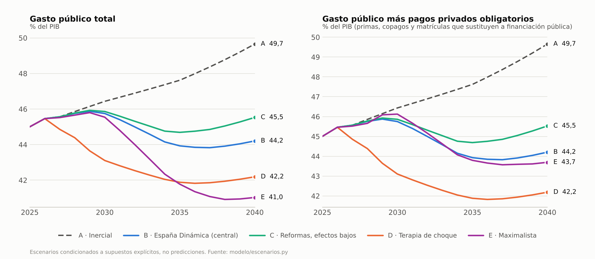

# España Dinámica 2040 · Versión maximalista

**Noviembre de 2026.** Este documento resume la versión maximalista del programa y la compara con la versión contrastada, que es la del [documento integrado](ESPANA_DINAMICA_2040.md). Las dos comparten diagnóstico, evidencia y modelo. Ninguna sustituye a la otra.

Las cifras salen del escenario E del [modelo](modelo/RESULTADOS.md), que supone que la reforma constitucional se aprueba en 2028. Son escenarios condicionados, no previsiones.

## 1. Qué es

La versión contrastada moderó el encargo inicial donde la evidencia lo aconsejaba. La maximalista aplica sin moderar cinco principios fijados por el promotor: liberalización profunda del trabajo, reducción sistemática del Estado, un Estado que solo produce seguridad y justicia, competencia real en lo privado e IA agéntica en la gestión pública.

Descansa en cuatro decisiones del promotor, recogidas con todos sus parámetros en [decisiones y parámetros de diseño](docs/05-version-maximalista/00-parametros-de-diseno.md):

1. Sanidad y educación con aseguramiento obligatorio, copago y retirada parcial de la financiación pública, y gestión privada en competencia.
2. Pensiones en cuentas individuales, aceptando el coste de transición.
3. Despido libre por reforma constitucional.
4. Convivencia con la versión contrastada, con escenario propio en el modelo.

## 2. Qué cambia, ámbito por ámbito

| Ámbito | Versión contrastada | Versión maximalista | Documento |
|---|---|---|---|
| Trabajo | Mochila del 1,5 % con causa del despido y control judicial | Contrato único de extinción libre, indemnización cero, mochila del 1,53 %, convenio de empresa prevalente, cinco puntos menos de cotización | [Trabajo](docs/05-version-maximalista/01-trabajo.md) |
| Sanidad | Financiación pública íntegra, sin copago | Seguro obligatorio, copago del 10 % con tope, subsidio según renta, centros en gestión privada entre 2029 y 2033 | [Sanidad y educación](docs/05-version-maximalista/02-sanidad-y-educacion.md) |
| Educación | Financiación pública íntegra | Cheque íntegro de 3 a 16 años y parcial después; préstamos ligados a la renta en la universidad; acreditación por resultados | [Sanidad y educación](docs/05-version-maximalista/02-sanidad-y-educacion.md) |
| Pensiones | Reparto con cuentas nocionales para los nacidos desde 1985 | Cuentas nocionales para los menores de 50; cuatro puntos de cotización a cuentas individuales; el Estado garantiza la mínima | [Pensiones](docs/05-version-maximalista/03-pensiones.md) |
| Estado y gasto | Eficiencia y reglas; ancla de saldo estructural | Lista positiva de funciones, estatuto solo para el núcleo, reposición cero en gestión, gasto real cero, venta del sector comercial | [Estado núcleo y gasto](docs/05-version-maximalista/04-estado-nucleo-y-gasto.md) |
| IA | Una mención a la tramitación automatizada | El Estado conserva datos, reglas y evaluación, y compra la ejecución a agentes en competencia | [Estado agéntico](docs/05-version-maximalista/05-estado-agentico.md) |
| Vía jurídica | Leyes ordinarias y orgánicas | Reforma de los arts. 35, 41, 43 y 103.3 por tres quintos | [Reforma constitucional y secuencia](docs/05-version-maximalista/06-reforma-constitucional-y-secuencia.md) |

## 3. Qué dice el modelo

| En 2040 | Central (B) | Maximalista (E) |
|---|---|---|
| Gasto público (% PIB) | 44,2 | 41,0 |
| Gasto público en sanidad y educación (% PIB) | 11,5 | 8,9 |
| Pagos obligatorios de los hogares (% PIB) | 0,0 | 2,7 |
| Gasto público más pagos obligatorios (% PIB) | 44,2 | 43,7 |
| Empleados públicos (miles) | 3.072 | 1.366 |
| Paro (%) | 7,0 | 6,8 |
| Paro máximo desde 2027 | 10,2 % (2027) | 10,6 % (2030) |
| PIB per cápita (2025 = 100) | 120,5 | 119,6 |
| Salario neto (2025 = 100) | 119,4 | 121,5 |
| Renta salarial neta tras pagos obligatorios (2025 = 100) | 119,4 | 113,0 |
| Saldo público (% PIB) | −2,0 | −1,0 |
| Deuda pública (% PIB) | 83,9 | 80,2 |
| Ahorro en cuentas individuales (% PIB) | 0,0 | 12,8 |

### Lo que la versión maximalista consigue

- **Un Estado mucho menor como productor.** La plantilla pública pasa de 3,07 a 1,37 millones. De la reducción, 1,43 millones son personal sanitario y docente que cambia de empleador y 275.000 son puestos de gestión que no se reponen.
- **Menos gasto público.** Baja 3,2 puntos de PIB frente a la versión contrastada.
- **Mejores cuentas desde mediados de los años treinta.** El saldo público supera al central desde 2036 y la deuda desde 2035. En 2040 la deuda es 3,7 puntos menor, de los que 2,4 son ventas de activos.
- **Patrimonio propio para los trabajadores.** Las cuentas individuales acumulan el 12,8 % del PIB en 2040.
- **Algo menos de paro y más salario neto.** El paro queda por debajo del central desde 2037 y el salario neto por encima desde 2031, por la menor cuña fiscal.
- **Una transición más suave que la terapia de choque.** El escenario D llegaba a un paro del 11,8 %; el E, al 10,6 %.

### Lo que no consigue, o cuesta

- **El gasto se traslada más que se reduce.** El 84 % de la bajada del gasto público reaparece como primas, copagos y matrículas que pagan los hogares. Sumando ambos, el total baja medio punto de PIB.
- **Los hogares disponen de menos renta.** El salario neto sube, pero una vez pagados sanidad y educación la renta salarial queda seis puntos por debajo de la versión contrastada.
- **No crece más.** El PIB per cápita no supera al de la versión contrastada antes de 2040. La transición deja más pérdida permanente de capacidad (2,1 % frente a 0,9 %).
- **Las cuentas empeoran antes de mejorar.** El déficit es mayor que en el central entre 2029 y 2035, porque el desvío a cuentas individuales y la rebaja de cotizaciones restan 3,15 puntos de PIB de ingresos.
- **El diseño incumpliría su propio freno.** La brecha de producción queda por debajo de −1 % durante ocho años (2029-2036), el umbral que activa la cláusula cíclica de la regla de gasto. El modelo no aplica ese freno; si se aplicara, el ajuste sería más lento.
- **La sanidad pública no baja al nivel previsto.** La retirada de 2,0 puntos se aplica sobre un gasto que el envejecimiento empuja al alza: queda en el 5,5 % del PIB en 2040, no en el 4,6 %.

## 4. El Estado agéntico

Es la parte del programa que menos depende de la reforma constitucional y la que más cambia la gestión pública.

- **Reparto de papeles.** El Estado mantiene los registros, publica cada norma con trámite como especificación ejecutable y evalúa. La ejecución se contrata a proveedores de agentes que compiten, con al menos dos por procedimiento crítico.
- **Regla de asimetría.** Lo favorable al ciudadano se resuelve de forma automática. Lo desfavorable lo propone el agente y lo revisa una persona si el interesado lo pide.
- **Autonomía ganada.** Cada agente empieza asistiendo y solo decide por sí mismo cuando su tasa de error medida es menor que la del proceso humano. Si empeora, baja de nivel.
- **Tres oleadas.** Prestaciones regladas, devoluciones y licencias en los primeros 18 meses; contratación, inspección y tramitación judicial hasta el mes 36; gestión tributaria completa y urbanismo legible por máquina hasta el mes 60.

El diseño funciona también si la tecnología avanza despacio: los agentes se quedan en niveles bajos y el ahorro de plantilla solo entra en el techo de gasto cuando la AIReF lo certifica. En el modelo, el efecto de la IA sobre la productividad agregada vale cero en el caso central.

## 5. Lo que exige

- **Tres quintos de ambas cámaras.** Son 210 diputados. A 15 de noviembre de 2026 las elecciones del día 29 no se han celebrado, y los sondeos dan al bloque afín entre 188 y 208 escaños. El [documento de reforma constitucional](docs/05-version-maximalista/06-reforma-constitucional-y-secuencia.md) describe un plan de reserva por ley ordinaria, que no está modelizado.
- **Tratados.** El despido necesita una causa formal hasta que surta efecto la denuncia del Convenio 158 de la OIT, cuya próxima ventana se abre en noviembre de 2035. El art. 24 de la Carta Social Europea se denuncia con efecto el 1 de julio de 2028; la notificación tiene que hacerse antes del 1 de enero de 2028.
- **Financiación de la transición.** El paso a cuentas individuales cuesta 1,4 puntos de PIB al año durante décadas.
- **Aceptación social del traslado de costes.** Unos 2,7 puntos de PIB pasan del presupuesto público al de los hogares.

## 6. Lo que este documento no sabe

- El modelo no representa la calidad de los servicios, la selección de riesgos en sanidad, los efectos por nivel de renta ni la capacidad real de la IA.
- La escala del subsidio sanitario está sin calibrar: falta cruzar renta y gasto sanitario por edad.
- Los datos de plantilla por sector (722.629 efectivos en sanidad y 707.723 en docencia no universitaria) proceden de fuentes secundarias y no se pudieron cotejar con el registro oficial. La proporción de personal de gestión (16 %) y la tasa de jubilación (4 % anual) son supuestos.
- Parte de la literatura que sostiene los parámetros está citada de memoria.
- La evidencia del proyecto sobre el despido libre, la competencia gestionada en sanidad y la privatización de monopolios naturales sigue siendo la que era. Cada documento la recoge en su sección de riesgos.

## Documentos

| Documento | Contenido |
|---|---|
| [Decisiones y parámetros](docs/05-version-maximalista/00-parametros-de-diseno.md) | Fuente única de parámetros |
| [Trabajo](docs/05-version-maximalista/01-trabajo.md) | Contrato único, extinción libre, negociación y cotizaciones |
| [Sanidad y educación](docs/05-version-maximalista/02-sanidad-y-educacion.md) | Seguro obligatorio, cheque, acreditación por resultados y modelos nuevos |
| [Pensiones](docs/05-version-maximalista/03-pensiones.md) | Cuentas nocionales e individuales y coste de transición |
| [Estado núcleo y gasto](docs/05-version-maximalista/04-estado-nucleo-y-gasto.md) | Lista positiva, función pública residual, regla de gasto y ventas |
| [Estado agéntico](docs/05-version-maximalista/05-estado-agentico.md) | Arquitectura, oleadas, mercado de agentes y evaluación |
| [Reforma constitucional y secuencia](docs/05-version-maximalista/06-reforma-constitucional-y-secuencia.md) | Artículos, aritmética parlamentaria, tratados, calendario y plan de reserva |
| [Revisión que la origina](docs/04-revision/01-revision-liberalizadora-ia.md) | Diagnóstico del programa contrastado frente a los cinco principios |
| [Resultados del modelo](modelo/RESULTADOS.md) | Escenario E, sensibilidad y límites |
