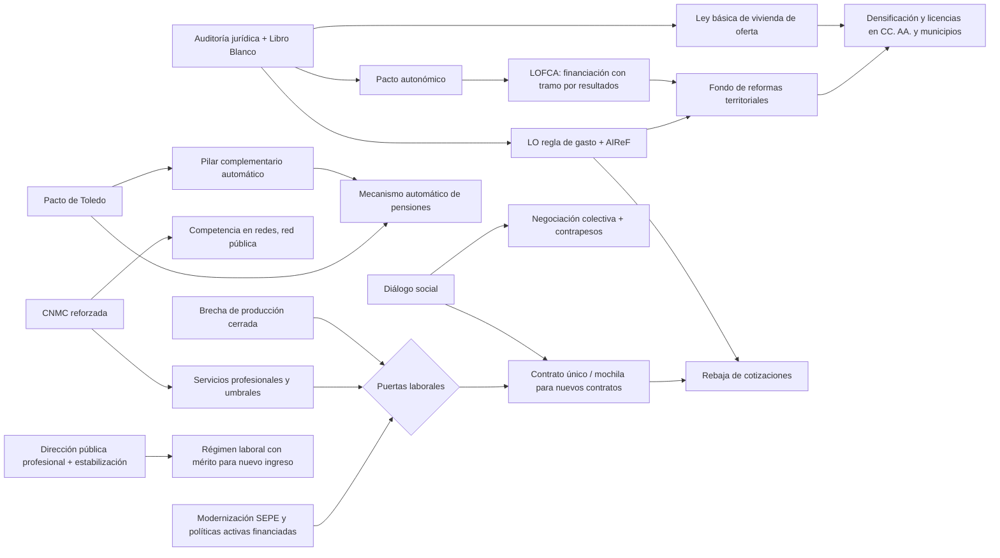

# 03-01 · Economía política, incentivos y secuencia

**Proyecto:** España Dinámica 2040 · **Fecha de corte:** 14 de noviembre de 2026
**Base:** marco conceptual (00), diagnóstico (01-01), evidencia internacional (01-02) y crítica (01-03, cuyas 12 condiciones se tratan aquí como requisitos).
**Marcas:** "(est.)" señala una estimación propia; "(no verificado)", un dato que no se pudo contrastar. 1 punto de PIB equivale a unos 17.000 M€.

---

## 0. Punto de partida político (noviembre de 2026)

- Las Cortes se disolvieron por el Real Decreto 806/2026 (BOE de 6 de octubre). Las generales se celebran el **29 de noviembre de 2026**, tras la derrota parlamentaria de los decretos de vivienda. La vivienda es ya el eje de la campaña.
- **Encuestas** (media de 11 institutos, 7 de noviembre, vía Sondaxe): PP 31,0 %, PSOE 26,2 %, Vox 19,5 %. Casi todos los sondeos dan a PP y Vox **entre 192 y 207 escaños**. El CIS es la excepción y sitúa primero al PSOE. Son sondeos, no resultados.
- **Consecuencia práctica:** con la disolución decayeron los proyectos en trámite, incluido el nuevo modelo de financiación autonómica (reforma de la LOFCA), que el CPFF aprobó en septiembre con el rechazo de 13 comunidades. La próxima legislatura hereda ese expediente.
- **Reloj electoral:** autonómicas (13 CC. AA.) y municipales en mayo de 2027, 2031, 2035 y 2039; generales hacia finales de 2030, 2034 y 2038 si se agotan las legislaturas. Las medidas de coste concentrado se aprueban en los 18 meses posteriores a cada elección y ninguna empieza a aplicarse en los 12 meses previos a unas generales.

---

## 1. Mapa de actores y de vetos

### 1.1 Aritmética e instrumentos

| Instrumento | Mayoría | Escaños | ¿Lo alcanza una mayoría de bloque? |
|---|---|---|---|
| Ley ordinaria / convalidación de RDL | Simple | Más síes que noes | Sí |
| Ley orgánica (votación final del conjunto) | Absoluta del Congreso | 176 | Sí, con una mayoría de bloque estable |
| Reforma constitucional (art. 167) | 3/5 de cada Cámara | 210 diputados | No: hace falta PP+PSOE |
| Reforma agravada (art. 168) | 2/3 + disolución + referéndum | 234 | Descartada |
| Elección de órganos (TC, CGPJ, AIReF por ley) | 3/5 | 210 | No |

El **Senado** (mayoría absoluta del PP desde 2023) puede vetar o retrasar dos meses las leyes ordinarias, pero no las bloquea. Además, elige 4 magistrados del TC; esa renovación está bloqueada desde finales de 2025.

### 1.2 Actores: qué ganan o pierden, poder de veto y qué los movería

| Actor | Gana / pierde con el programa | Poder de bloqueo | Qué lo movería |
|---|---|---|---|
| **PP** | Gana con la agenda de oferta y vivienda; pierde votantes mayores y propietarios si toca pensiones o densifica | Alto (probable gobierno, mayoría en el Senado) | Dividendos tempranos; pensiones pactadas |
| **PSOE** | Pierde la identificación con la reforma de 2021 y la indexación al IPC; gana si comparte autoría | Alto en todo lo que exige 3/5 y en los pactos de Estado | Red de transición antes de flexibilizar, mochila sin abaratar el despido, parque asequible |
| **Vox** | Gana con vivienda y fiscalidad; su electorado mayor y de sectores protegidos y su posición en inmigración laboral chocan con partes del programa | Medio-alto si es socio necesario | Vivienda joven y simplificación; menos peso en lo pactado con el PSOE |
| **Sumar, Podemos, izquierda territorial** | Pierden en lo laboral y en la vivienda regulada | Bajo en el Congreso; alto en la calle y en ayuntamientos | Vivienda asequible, contrapesos al monopsonio, salario mínimo |
| **PNV, Junts, CC, ERC, Bildu, BNG** | Ganan con financiación que respete competencias; pierden con recentralización | Decisivos si el bloque no suma 176 | Fondo voluntario; respeto del concierto y el cupo |
| **CC. AA.** (unas 11-12 con presidencia o participación del PP; est., no verificado) | Tienen urbanismo, vivienda, sanidad, educación, políticas activas y comercio. Ganan con financiación adicional y pierden autonomía si se condiciona | Muy alto: aplican el 70 % del programa | Fondo de reformas por resultados, comparación pública, pacto de financiación |
| **Ayuntamientos** (más de 8.000) | Licencias y planeamiento. Ganan con la financiación ligada a viviendas terminadas; pierden con la presión de sus votantes propietarios | Alto en vivienda | Transferencia por vivienda terminada, captura de plusvalías para infraestructuras |
| **CCOO y UGT** | Pierden poder en la negociación salarial si se descentraliza. Ganan con políticas activas, formación y mochila con gestión paritaria | Afiliación del 12-13 % (Funcas/OCDE, 2026), pero unos 266.000 delegados que representan a unos 16 millones de asalariados; capacidad de huelga general y de litigio (CEDS, OIT) | Diálogo social con contrapartidas: mochila con fondo paritario, formación, salario mínimo |
| **CEOE y Cepyme** | Ganan con la simplificación, los umbrales y la unidad de mercado. Pierden con la competencia en sus sectores protegidos y con el coste de la mochila | Medio; veto en el diálogo social | Rebaja de cotizaciones compensatoria; supresión de umbrales |
| **Funcionarios** (3,07 millones de efectivos, EPSAP enero de 2026) | Los actuales conservan su estatuto. Pierden con la evaluación y la movilidad; ganan con la carrera y la dirección profesional | Medio-alto (sindicatos sectoriales, docentes, sanitarios) | Cláusula de derechos adquiridos (*grandfathering*), sin despidos, estabilización de interinos con concurso |
| **Pensionistas** (≈9,5-9,6 millones de personas y 10,57 millones de pensiones, octubre de 2026) | Pierden si se desindexa. El programa no toca las pensiones causadas | Muy alto (ver 1.3) | Garantía legal del poder adquisitivo de las pensiones causadas; los cambios solo se aplican a cohortes futuras |
| **Propietarios frente a inquilinos** | Los propietarios (≈75 % de los hogares; no verificado) pierden plusvalía latente con la densificación. Los inquilinos (54,7 % de los menores de 30) ganan | Los propietarios dominan el voto municipal | Densificación con mejora del barrio y plusvalía compartida (subir alturas revaloriza el edificio existente) |
| **Colegios profesionales, notarios, registradores, farmacias, estibadores, taxis** | Pierden rentas de entrada | Alto en lo técnico y lo mediático; bajo en lo electoral | Derechos adquiridos con calendario, rescate parcial de licencias |
| **Sectores regulados** (energía, telecomunicaciones, ferrocarril, agua) | Los entrantes ganan, los incumbentes pierden | Captura regulatoria | Reguladores fuertes y estables (condición 6) |
| **Tribunal Constitucional** | Árbitro de competencias (STC 61/1997 sobre suelo, STC de 2017 sobre la LGUM) y de los arts. 35, 41, 47 y 50 | Anulación ex post | Auditoría constitucional previa; diseños cooperativos y no de eficacia nacional |
| **Comisión Europea** | Gana con la senda de gasto neto (déficit del 0,8 % en 2031) y con las reformas del Semestre. Rechazaría un desmontaje laboral | Procedimiento de déficit excesivo, recomendaciones | Plan fiscal-estructural que incluya el programa como reformas que justifican una senda gradual |

### 1.3 El peso electoral de los mayores, cuantificado

- **Electores de 65 o más años:** 10,18 millones de 35,96 millones de electores residentes, el **28,3 %** del censo (Oficina del Censo Electoral, vía Europa Press; conviene confirmar la convocatoria exacta).
- **Votos emitidos:** con participación del 75-80 % entre mayores frente al 55-65 % entre menores de 35 (no verificado), los mayores de 65 aportan ≈**31-33 % de los votos** (est.); sumando la franja de 55-64 años, ≈**45-48 %** (est.).
- **Implicación:** una reforma de pensiones no pactada no sobrevive a dos elecciones (la de 2013 se revirtió en 2021-2023). Pensiones, solo por pacto de Estado y para cohortes futuras.

---

## 2. La lógica de Olson aplicada

### 2.1 Diagnóstico

Las pérdidas del programa son **concentradas, inmediatas y fáciles de atribuir**: el notario, el taxista, el funcionario evaluado, el propietario del barrio que se densifica, el sindicato que pierde la prioridad del convenio sectorial. Los beneficios son **dispersos, diferidos y difíciles de atribuir**: el joven que se emancipa dos años antes, el consumidor que paga un 10 % menos, la pyme que pasa de 49 a 80 empleados. Los perdedores saben quiénes son y se organizan; los ganadores no saben que lo son.

### 2.2 Cómo convertir beneficiarios dispersos en coalición

1. **Hacer visible el beneficio:** cuadro de mando mensual por municipio (plazo de licencia, viviendas terminadas, precios de servicios liberalizados).
2. **Convertir derechos en patrimonio individual:** mochila y pilar complementario crean saldos a nombre de cada trabajador; millones de titulares defienden su saldo (el auto-enrolment británico pasó del 55 % al 88-90 % de participación, DWP).
3. **Agrupar por generación, no por sector:** un "paquete de emancipación" (vivienda, contrato único, cuña fiscal) dirigido a los menores de 40, en torno al 30 % del censo (est.).
4. **Neutralizar a los actores con veto con dinero acotado y temporal** (derechos adquiridos, rescate de licencias, fondo de reformas) en lugar de renunciar a la reforma.
5. **Dar autoría a los perdedores organizados:** la reforma laboral de 2021, pactada con CEOE, CCOO y UGT, ha sobrevivido; la de 2012, impuesta, no.

### 2.3 Lecciones de quién reformó y sobrevivió

| Caso | Qué hizo | Resultado político | Lección |
|---|---|---|---|
| **Canadá 1995** | Revisión de programas; recortes de ≈17.000 M CAD | Liberales reelegidos en 1997 y 2000 | Ajuste gradual con hitos alcanzables es compatible con la reelección, aunque trasladó costes a las provincias |
| **Suecia 1994-98** | Cuentas nocionales pactadas por cinco partidos (≈85 % del Parlamento); techo de gasto | Sobrevivió a todas las alternancias | Lo que se pacta no se revierte |
| **Alemania, Hartz 2003-05** | Servicios de empleo y recorte de prestaciones | El SPD perdió en 2005 y sufrió una escisión (WASG, luego Die Linke) | Quien impone recortes a su base paga el coste aunque la reforma perdure; separar la mejora de servicios del recorte |
| **Portugal 2011-15** | Indemnización de 30 a 20 días, convenios descentralizados, bajo la troika | PSD-CDS ganó en votos en 2015 pero perdió el gobierno; reversión parcial | Lo atribuido a un actor externo no genera dueños internos |
| **Francia, pensiones 2023** | Edad de 62 a 64 años por el art. 49.3, sin votación final | Pérdida de mayoría en 2024; reforma suspendida en otoño de 2025 (no verificado en esta revisión) | Pensiones sin votación ni pacto acaban revertidas |
| **Italia, Jobs Act 2015** | Protección creciente más bonificaciones | El TC anuló en 2018 el cálculo automático; el Decreto Dignità lo endureció | Sin seguridad jurídica la reforma se erosiona; las bonificaciones compran efectos temporales |
| **España 2012 frente a 2021** | 2012 unilateral; 2021 con diálogo social | 2012 revertida en parte; 2021 intacta | El método importa tanto como el contenido |

**Síntesis.** Sobreviven las reformas pactadas, con ganadores tempranos, graduales, con derechos adquiridos respetados y blindadas por instituciones técnicas. Se revierten las impuestas por mayoría estrecha o por procedimientos excepcionales.

---

## 3. Paquete de incentivos

### 3.1 Institucionales y de credibilidad

- **Regla de gasto estructural** plurianual para todas las administraciones (techo de legislatura al estilo sueco o Zalm), con cláusula cíclica automática, ajuste máximo de 0,5 puntos estructurales al año e inversión habilitante protegida. Reforma de la LO 2/2012 (176).
- **AIReF reforzada:** previsiones vinculantes, *spending reviews* con respuesta motivada ("cumplir o explicar") y presidencia elegida por 3/5. Ley orgánica.
- **Caducidad:** toda norma que cree cargas o barreras de entrada caduca a los 8 años salvo revalidación tras evaluación (Leyes 50/1997 y 39/2015).
- **Evaluación ex post obligatoria** a los 3 y 6 años, con datos administrativos abiertos.
- **Unidad de ejecución** en Presidencia, con equipo propio y mandato superior a la legislatura.

### 3.2 Compensatorios (coste en % del PIB; est.)

| Compensación | A quién | Coste anual | Duración | Derechos adquiridos |
|---|---|---|---|---|
| Modernización de los servicios de empleo (perfilado, gestión por casos, al estilo de Hartz I-III) y refuerzo de las políticas activas | Parados y trabajadores en transición | +0,3-0,5 | 2027-2033, después según evaluación | — |
| Coste de transición de la mochila: aportación empresarial a la cuenta compensada con una rebaja de cotizaciones | Empresas, para que el coste laboral total no suba | 0,2-0,4 | 2029-2040, decreciente | Los contratos vigentes conservan su régimen de indemnización |
| Seguro salarial para desplazados mayores de 50 y complemento salarial tipo EITC para salarios bajos | Perdedores de la reasignación | 0,2-0,3 | Permanente; el seguro salarial, 2029-2036 | — |
| Fondo de reformas territoriales (vivienda, licencias, unidad de mercado) | CC. AA. y ayuntamientos que cumplan hitos | 0,2-0,3 (3.400-5.100 M€) | 2028-2035 | — |
| Rescate parcial de licencias y autorizaciones (taxi, farmacias, estiba y otras) | Titulares actuales | Pago único de 0,05-0,1 en total | 2028-2031 | Calendario de apertura gradual de 5 a 10 años |
| Garantía del poder adquisitivo de las pensiones causadas y refuerzo de los complementos a mínimos ante el ajuste automático | Pensionistas actuales y de renta baja | 0,1-0,2 | Permanente | Pensiones causadas intocables; los cambios solo afectan a cohortes futuras |
| Aportación pública a la cuenta del pilar complementario para salarios bajos | Trabajadores de renta baja | 0,1-0,15 | Permanente | — |
| Estabilización de interinos por concurso-oposición y plan de carrera | Empleo público | Coste neutro o bajo | 2027-2031 | Funcionarios actuales conservan el estatuto |
| **Total** | | **≈1,2-1,9 en el pico (2029-2032)**; ≈0,6-0,9 en régimen permanente | | |

**Financiación** (condición 1: aritmética explícita). Las compensaciones deben caber bajo el techo de gasto y no añadirse a él. Fuentes: (i) reasignación de bonificaciones a la contratación de eficacia baja, según la evaluación de la AIReF (importe no verificado; del orden de varios miles de millones); (ii) ahorros identificados en las *spending reviews* (subvenciones, beneficios fiscales); (iii) parte del dividendo de crecimiento a partir del año 4. Si en un año no hay financiación verificada para una compensación, **la medida compensada se retrasa**: la compensación es precondición, no adorno (condición 3).

### 3.3 Electorales: dividendos visibles tempranos

Los meses se cuentan desde la investidura, prevista hacia enero o febrero de 2027 (mes 0).

| Mes | Dividendo | Ganadores visibles |
|---|---|---|
| 3 | Declaración responsable para obras menores, aperturas de comercio y cambios de uso de local a vivienda en zonas tensionadas (vía ley básica estatal más adhesión autonómica) | Pymes, autónomos |
| 4-6 | Deflactación parcial del IRPF para rentas bajas y medias (coste de unos 0,1-0,2 puntos; est.), presentada como "devolución de la progresividad en frío" | Asalariados de renta media |
| 6 | Cuadro de mando público de licencias, precios regulados y plazos por municipio | Ciudadanía y prensa |
| 9-12 | Primeras rebajas de precios en servicios liberalizados (ITV, aranceles notariales y registrales, autoescuelas) | Consumidores |
| 12 | Supresión o elevación de los umbrales de 50 empleados y de 6 M€ de facturación | Pymes en crecimiento |
| 12-18 | Licencias de obra mayor en menos de 4 meses en los municipios adheridos | Promotores, cooperativas |
| 18-24 | Primeras viviendas terminadas por conversión de oficinas y locales y por levante de plantas; primeras convocatorias del fondo territorial | Jóvenes, inquilinos |
| 24 | Contrato único y mochila para nuevas contrataciones (solo si se cumplen las puertas) | Jóvenes, temporales |

La vivienda nueva de obra completa no llega antes del mes 30-36. **No se promete asequibilidad en 1-3 años** (condición 10): se promete, y se mide, el plazo de licencia y el número de viviendas iniciadas.

### 3.4 Territoriales

- **Fondo de reformas** al estilo NextGen: pago por hitos verificados (AIReF/CNMC), no por proyectos: licencia media por debajo de 90 días, plan de densificación aprobado, viviendas terminadas por cada 1.000 hogares nuevos, adhesión al reconocimiento mutuo.
- **Transferencia municipal por vivienda terminada** en zonas tensionadas (est.: 3.000-6.000 €), que compensa el coste de servicios y la resistencia vecinal.
- **Competencia por comparación:** ranking anual (licencias, unidad de mercado, eficiencia sanitaria y educativa).
- **Tramo por resultados** en la financiación autonómica (est.: 2-3 % de los recursos) y regla de gasto autonómica.
- **Voluntariedad:** quien no se adhiere no cobra. Evita el conflicto competencial (STC 61/1997) y crea efectos demostración.

### 3.5 Culturales y de experimentación

- **Pilotos con despliegue escalonado o aleatorio** (perfilado de parados, ventanillas únicas de licencia, cheque de formación portable), para evitar la autoselección (crítica 9).
- **Zonas de tramitación acelerada y reconocimiento mutuo**, no "zonas sin regulación", compatibles con los arts. 14 y 139 CE.
- **Métricas trimestrales de dinamismo** (INE/AIReF): entrada y salida de empresas, transiciones de empleo a empleo, empresas que cruzan los 50 empleados, plazos de licencia.

---

## 4. Secuencia de implementación 2027-2040

### 4.1 Principios de orden

1. **Productos antes que trabajo**, y **regulador antes que privatización**.
2. **Red de transición financiada y operativa antes de flexibilizar.**
3. **Ancla fiscal primero, ajuste gradual después.**
4. **Auditoría constitucional y pacto autonómico antes de legislar en competencias compartidas.**
5. **Pocas medidas simultáneas:** como máximo 3 o 4 reformas núcleo en ejecución a la vez (crítica 9.7).
6. **Las medidas de coste concentrado se aprueban al principio de cada ciclo electoral.**

### 4.2 Fases

**Fase 0. Preparación (diciembre de 2026 a junio de 2027; parte se adelanta a la investidura).**
- Auditoría jurídica por medida (rango normativo, competencias, UE, OIT 158, Carta Social Europea).
- Libro Blanco: fuentes y usos año a año, incidencia por decila y provincia, indicadores de las puertas.
- Tres mesas: diálogo social (mochila, políticas activas), Pacto de Toledo y Conferencia de Presidentes (financiación, vivienda).
- Plan fiscal-estructural revisado ante la Comisión, con el programa como reformas.
- Lo territorial se negocia con los gobiernos salidos de mayo de 2027.

**Fase 1. Primeros 100 días y primeros 2 años (2027-2028): victorias rápidas y cimientos.**

| Medida | Instrumento | Mayoría | Depende de | Por qué ahora |
|---|---|---|---|---|
| Reforma de la LO 2/2012: regla de gasto, AIReF reforzada | Ley orgánica | 176 | Fase 0 | El ancla da credibilidad a todo lo demás y su coste político es bajo |
| Ley de simplificación y caducidad normativa; declaración responsable | Ley ordinaria (bases, art. 149.1.13 y 18) | Simple | Auditoría | Dividendo visible, coste bajo |
| CNMC reforzada: presupuesto propio, mandatos no renovables, régimen de puertas giratorias; separación orgánica de la autoridad de competencia | Ley ordinaria | Simple | — | Precondición de toda liberalización y de cualquier privatización |
| Liberalización de servicios profesionales y reservas de actividad (colegiación obligatoria solo con justificación de riesgo); aranceles | Ley ordinaria y reales decretos | Simple | CNMC | Productos antes que trabajo |
| Supresión o elevación de umbrales (50 empleados, 6 M€) | Ley ordinaria y RD | Simple | — | Coste bajo, ganadores visibles |
| Ley de unidad de mercado 2.0 (reconocimiento mutuo voluntario y cooperativo, compatible con la STC de 2017) | Ley ordinaria y convenios | Simple | Pacto autonómico | Necesita a las CC. AA. |
| Modernización del SEPE y de los servicios autonómicos de empleo; perfilado | Ley de Empleo, RD, convenios | Simple | Financiación del fondo | Red antes que flexibilidad: necesita 2-3 años para funcionar |
| Ley básica de vivienda de oferta: silencio positivo en licencias tasadas, cambio de uso, edificabilidad en zonas urbanas consolidadas por adhesión, macroprudencial (LTV y DSTI) activado por el Banco de España | Ley ordinaria (149.1.1, 13 y 18) más legislación autonómica | Simple; acción autonómica y municipal | Auditoría, pacto autonómico | Es el problema central del electorado en 2026 |
| Estabilización de interinos y dirección pública profesional (desarrollo del art. 13 EBEP) | Ley ordinaria y RD | Simple | — | Mérito antes que cualquier flexibilidad (condición 9) |

**Fase 2. Años 2 a 5 (2028-2031): reformas núcleo.**

| Medida | Instrumento | Mayoría | Depende de | Por qué ahora |
|---|---|---|---|---|
| Nuevo modelo de financiación autonómica con tramo por resultados y regla de gasto autonómica | LO de reforma de la LOFCA, CPFF, ley ordinaria del sistema | 176 + pacto de Estado | Pacto PP-PSOE y CC. AA. | Hace de palanca de toda la reforma territorial |
| Fondo de reformas territoriales | Ley de Presupuestos, convenios | Simple | Regla de gasto | Incentiva la vivienda y la unidad de mercado |
| Pensiones: mecanismo automático pactado (factor de sostenibilidad ligado a la esperanza de vida o transición a cuentas nocionales para cohortes nacidas después de 1975, por ejemplo), cómputo de toda la carrera, garantía de mínimos | Ley ordinaria (LGSS), con base en un acuerdo del Pacto de Toledo | Simple, pero se busca 3/5 político | Pacto de Toledo | Aplicación diferida y gradual. Sin pacto no se legisla |
| Pilar complementario de adscripción automática, con salida voluntaria, gestión por fondos de empleo con comisiones topadas y aportación inicial del 3 % que sube al 6-8 % | Ley ordinaria | Simple | Diálogo social | Crea propietarios de saldo antes de los ajustes |
| Contrato único o mochila para **nuevas** contrataciones, con *bonus-malus* contra la rotación, causalidad mantenida (art. 35 CE, OIT 158) y contratos vigentes intactos | RDL convalidado o ley ordinaria (ET) | Simple | Puertas L1-L3 (servicios de empleo operativos, brecha de producción cerrada, mercados de productos liberalizados) | Va después de la red y de los productos (condiciones 3, 4 y 6) |
| Negociación colectiva: descuelgue ágil, prioridad del convenio de empresa en organización del trabajo, salario mínimo como suelo y prohibición de cláusulas de no competencia | Ley ordinaria (ET) | Simple | Diálogo social | Contrapeso al monopsonio (condición 5) |
| Régimen laboral con mérito para funciones que no son de autoridad, en el nuevo ingreso; órgano independiente para despidos objetivos | Reforma del EBEP (ley ordinaria básica) | Simple | Dirección profesional ya operativa | Mérito garantizado antes (condición 9); no en año preelectoral |
| Competencia gestionada en ferrocarril y otras redes con la titularidad pública de la red | Ley ordinaria sectorial | Simple | CNMC reforzada | Regulador antes que operador |

**Fase 3. Años 5 a 10 (2031-2036): consolidación.** Rebaja de cotizaciones de 1-2 puntos (Presupuestos y LGSS); opción voluntaria de conversión de contratos vigentes a la mochila; evaluación a 6 años y caducidad de lo que no la supere; densificación en todas las áreas metropolitanas tensionadas, con el objetivo de más de 200.000 viviendas terminadas al año (est., coherente con la proyección de hogares del INE); externalización solo de servicios técnicos medibles, sin privatizar redes (condición 7).

**Fase 4. Más de 10 años (2037-2040): régimen permanente.** Regla de gasto y ajuste automático de pensiones sin intervención discrecional; revisión de programas por ciclos de cuatro años; extinción de las compensaciones temporales (fondo territorial, seguro salarial, rescate de licencias); reforma constitucional mínima (art. 135) solo si hay consenso de 3/5, porque no es imprescindible.

### 4.3 Diagrama de dependencias

### 4.4 Gantt simplificado

| Medida | 2027 | 2028 | 2029-30 | 2031-32 | 2033-36 | 2037-40 |
|---|---|---|---|---|---|---|
| Auditoría, Libro Blanco, mesas | ■■ | | | | | |
| Regla de gasto y AIReF (LO) | ■■ | ■ | → | → | → | → |
| Simplificación, umbrales, profesiones | ■■ | ■■ | ■ | eval. | caducidad | |
| CNMC reforzada | ■■ | ■ | → | → | → | → |
| SEPE y políticas activas | ■ | ■■ | ■■ | ■ | eval. | |
| Ley de vivienda de oferta y macroprudencial | ■■ | ■■ | ■■ | ■ | ■ | → |
| Financiación autonómica y fondo de reformas | mesa | ■■ | ■■ | ■■ | ■ | fin fondo |
| Pacto de Toledo y pilar complementario | mesa | ■■ | ■■ (aplicación) | ■ | → | → |
| Mecanismo automático de pensiones | | mesa | ley | aplicación gradual | ■ | → |
| Contrato único o mochila (nuevos) | | | ■■ (si puertas) | ■ | generalización | → |
| Negociación colectiva y contrapesos | | ■ | ■■ | | eval. | |
| Función pública: dirección y mérito | ■■ | ■■ | ■ (nuevo ingreso) | ■ | ■ | → |
| Rebaja de cotizaciones | | | | ■ | ■■ | ■ |
| Hitos electorales | autonómicas y municipales (V-27) | | generales (≈XI-30) | autonómicas y municipales (V-31) | generales (≈2034), autonómicas y municipales (2035) | generales (≈2038), autonómicas y municipales (2039) |

■■ = aprobación o despliegue principal; ■ = despliegue; → = régimen; eval. = evaluación obligatoria.

---

## 5. Qué requiere cada instrumento

| Nivel | Medidas | ¿Sin mayoría absoluta? |
|---|---|---|
| **Reforma constitucional (3/5)** | Ninguna imprescindible. Opcionales: regla de gasto reforzada (art. 135) y unidad de mercado | No. Solo con PP y PSOE |
| **Ley orgánica (176)** | Regla de gasto y AIReF (LO 2/2012), LOFCA, cualquier cambio en el régimen electoral o en el TC | No: necesita 176 en la votación final |
| **Ley ordinaria** | Simplificación, CNMC, profesiones, umbrales, vivienda básica, Estatuto de los Trabajadores (mochila, negociación), LGSS (pensiones), pilar complementario, EBEP, ferrocarril | Sí, con mayoría simple y la abstención de terceros |
| **Real decreto-ley** (convalidación en 30 días) | Medidas urgentes del ET y fiscales | Sí, pero frágil: en 2026 se derrotaron varios. No sirve para reformas núcleo |
| **Reglamento o real decreto** | Aranceles notariales y registrales, ITV, perfilado del SEPE, desarrollo del EBEP | Sí, sin pasar por el Parlamento |
| **Solo acción autonómica** | Urbanismo, licencias, edificabilidad, políticas activas, gestión sanitaria y educativa, horarios comerciales | Sí, en cada comunidad: es la vía "desde abajo" |
| **Solo acción municipal** | Plazos de licencia, ordenanzas, planes de densificación, IBI e ICIO | Sí |
| **Pacto de Estado** (aunque jurídicamente baste la mayoría simple o la orgánica) | **Pensiones** (Pacto de Toledo) y **financiación autonómica** (CPFF y LOFCA). También, por su reversibilidad, la reforma laboral | Técnicamente sí; políticamente no conviene |

---

## 6. Puertas de decisión, criterios de fracaso y mecanismos contra la reversión

### 6.1 Puertas de paso entre fases

| Puerta | Condición para avanzar | Fecha límite |
|---|---|---|
| **F1** (ajuste fiscal) | Brecha de producción > −1 % (AIReF/CE). Si no se cumple, la cláusula cíclica suspende el ajuste del año | Anual |
| **L1** (red de transición) | Servicios de empleo con perfilado operativo en CC. AA. que sumen ≥70 % de los parados; fondo de transición ejecutado ≥80 % | Diciembre de 2028 |
| **L2** (productos antes que trabajo) | Ley de profesiones aprobada y CNMC reforzada en vigor | Diciembre de 2028 |
| **L3** (ciclo) | Paro por debajo del 10 % y sin aumento interanual en dos trimestres seguidos | En el momento de legislar |
| **P1** (pensiones) | Acuerdo del Pacto de Toledo con grupos que sumen ≥210 escaños | Antes de legislar; sin acuerdo, solo pilar complementario |
| **V1** (vivienda) | Macroprudencial activo; crédito hipotecario nuevo con crecimiento por debajo del PIB nominal + 2 puntos | Continuo |
| **R1** (redes) | Test de contestabilidad y contratabilidad superado, y límites de apalancamiento y dividendos en vigor | Antes de cada licitación |

### 6.2 Criterios de pausa o corrección automática

Los mide trimestralmente una comisión técnica (AIReF, INE y Banco de España). Si se dispara uno de ellos, el Gobierno debe presentar un plan de corrección en 60 días o pausar la medida.

| Indicador | Línea base | Umbral de alerta |
|---|---|---|
| Tasa de paro | 10,18 % (3T 2026) | +1,5 puntos en 4 trimestres sin explicación por el ciclo de la zona del euro |
| Paro de larga duración (% del total) | (por fijar en la Fase 0) | +5 puntos en 2 años |
| AROPE / pobreza infantil | 25,7 % (2025) / (por fijar) | +1 punto dos años seguidos |
| Precio de la vivienda / renta | 7,98 años (2025) | Por encima de 8,5 en 2030 con viviendas terminadas en zonas tensionadas por debajo de los hogares creados: escalar los instrumentos estatales |
| Plazo medio de licencia en municipios adheridos | 8-12 meses | Más de 4 meses en 2029: retención del fondo |
| Prima de riesgo frente al Bund | (por fijar) | Más de 200 pb durante 3 meses: revisión de la senda y de la credibilidad |
| Ratio despidos / contrataciones indefinidas (tras la mochila) | (por fijar) | +20 % sostenido: activar el *bonus-malus* |
| Margen y concentración (IHH) en sectores liberalizados | (por fijar) | Sube el margen sin bajar el precio: actuación de la CNMC |
| Rotación de personal público tras elecciones | (por fijar) | Más ceses de los habituales en los 12 meses siguientes a un cambio de gobierno: congelación del régimen laboral |

### 6.3 Mecanismos contra la reversión

1. **Pacto antes que mayoría** en pensiones y financiación; diálogo social en lo laboral.
2. **Derechos patrimoniales individuales** (mochila, pilar complementario): revertirlos expropia saldos visibles.
3. **Rango orgánico** para el ancla fiscal y nombramientos por 3/5 en la AIReF y la CNMC.
4. **Compromisos europeos:** reformas inscritas en el plan fiscal-estructural y en el Semestre.
5. **Convenios plurianuales con las CC. AA.**, cuyos hitos vinculan a los gobiernos siguientes.
6. **Evaluación en lugar de irreversibilidad forzada:** lo que funciona y se mide cuesta más derogarlo; lo que no funciona debe caer.
7. **Ganadores organizados** (inquilinos, jóvenes, pymes) con acceso a los datos del cuadro de mando.

---

## 7. Estrategia de comunicación

**Marco narrativo:** "Que trabajar, emprender y emanciparse vuelva a compensar." Es una promesa generacional y de oportunidad, no de recorte. Los tres pilares del relato son la casa, el contrato y el sueldo neto.

**Qué no decir**
- "Despido libre", "desmantelar el Estado", "privatizar la sanidad o el agua": no forman parte del programa (condiciones 4, 7 y 8) y movilizan a todos los perdedores a la vez.
- "Recortar pensiones": la formulación correcta es "garantizar las pensiones de hoy y hacer sostenibles las de mañana", con la protección de las pensiones causadas por escrito.
- Plazos de asequibilidad que no se pueden cumplir ("la vivienda bajará en dos años").
- Descalificar a sindicatos, funcionarios, pensionistas o colectivos profesionales. Se habla de reglas, no de culpables.

**Cómo se explican los costes de corto plazo:** se anuncian antes y con cifras (el Libro Blanco publica quién pierde, cuánto y qué compensación recibe); cada coste va unido a su compensación y a su puerta ("no se toca el contrato hasta que el servicio de empleo funcione, y lo comprobará la AIReF"); y se ilustran con casos locales medibles.

**Quién gana en los primeros 24 meses:** autónomos y pymes (simplificación, umbrales), consumidores de servicios profesionales e ITV, contribuyentes de renta media (deflactación), jóvenes inquilinos en los municipios adheridos (licencias, conversiones) y parados atendidos por el nuevo servicio de empleo. **Quién no gana todavía:** los compradores de vivienda en las grandes ciudades. Eso se dice abiertamente.

---

## 8. Tres trayectorias políticas

| Trayectoria | Descripción | Probabilidad cualitativa | Qué sobrevive |
|---|---|---|---|
| **A. Pacto amplio** | Gobierno de un bloque con acuerdos de Estado con el principal partido de la oposición en pensiones, financiación, regla fiscal y órganos (AIReF, TC, CNMC) | **Baja-media** (≈20-30 %; est.). La polarización de 2023-2026 y el bloqueo del TC juegan en contra. La presión europea y la vivienda como prioridad compartida, a favor | **Casi todo (80-90 %)**: ancla fiscal, pensiones paramétricas o nocionales, pilar complementario, financiación con resultados, vivienda, mochila con diálogo social. Reversión improbable |
| **B. Mayoría reformista estrecha** | Bloque de 176-207 escaños, como apuntan los sondeos, con la oposición principal en contra | **Media-alta** (≈45-55 %; est.) | **≈55-65 %**: simplificación, CNMC, profesiones, umbrales, regla de gasto, vivienda (estatal y en CC. AA. afines), función pública. **En riesgo:** pensiones (solo pilar complementario y medidas suaves), financiación (prórroga del modelo actual) y mochila (reversible en 2030-31 sin diálogo social). Posibles tensiones internas en inmigración laboral y sectores protegidos |
| **C. Desde abajo** | Sin mayoría estatal estable o con Gobierno central contrario; avanzan CC. AA. y ayuntamientos | **Media** como escenario parcial (≈20-30 %; est.), en buena parte **complementario** de A o B | **≈30-40 %**: licencias, densificación, macroprudencial (depende del Banco de España), simplificación autonómica, políticas activas, gestión sanitaria y educativa, cuadro de mando. **No sobrevive:** regla estatal, mercado laboral, pensiones, profesiones y financiación |

**Implicación estratégica.** Diseñar para B, tender puentes hacia A (pactos ofrecidos desde el primer día, con autoría compartida en la red de transición y la vivienda asequible) y activar C de inmediato donde haya voluntad, porque genera la evidencia doméstica que hace viable A en la legislatura siguiente. Lo que no pueda sobrevivir a una alternancia en 2030 o 2034 se aplaza hasta que haya pacto.

---

## Fuentes principales (consultadas en noviembre de 2026)

- Real Decreto 806/2026 de disolución y convocatoria (BOE, 6 de octubre de 2026), vía [elderecho.com](https://elderecho.com/el-boe-publica-la-disolucion-de-las-cortes-tras-la-convocatoria-de-elecciones-generales-el-29-de-noviembre); motivo del adelanto, vía [Euronews](https://es.euronews.com/2026/10/04/sanchez-estudia-convocar-elecciones-generales-el-proximo-29-de-noviembre) y [Diari de Tarragona](https://www.diaridetarragona.com/espana/272426/pedro-sanchez-fia-supervivencia-movilizacion-vivienda_amp.html).
- Encuestas: [Demócrata, More in Common](https://www.democrata.es/encuestas/29n-pp-aventaja-psoe-por-menos-punto-vox-supera-20-segun-more-in-common/); [Demócrata, Sondaxe y media](https://www.democrata.es/encuestas/elecciones-generales/encuesta-elecciones-generales-urda-pp-sube-297-psoe-tambien-273-vox-baja-186-segun-sondaxe/); [Qué!, 9 de noviembre de 2026](https://www.que.es/2026/11/09/encuestas-29n-pp-vox-199-escanos/).
- Censo de mayores de 65 años: [Demócrata / Europa Press](https://www.democrata.es/politica/mas-de-10-millones-de-mayores-de-65-anos-podran-votar-en-las-generales-casi-un-30-del-censo-en-espana/). Pensionistas: [Seguridad Social, octubre de 2026](https://revista.seg-social.es/-/la-pension-media-del-sistema-de-la-seguridad-social-alcanza-los-1.376-1-euros-en-octubre-un-4-6-mas-alta-que-hace-un-ano); [BBVA Mi Jubilación](https://www.bbvamijubilacion.es/blog/la-pension-media-de-jubilacion-en-octubre-alcanza-los-1-5776-euros-y-la-del-regimen-general-1-736-euros/).
- Financiación autonómica: [Artículo14, CPFF de septiembre de 2026](https://www.articulo14.es/politica/castilla-la-mancha-y-asturias-ambas-del-psoe-ratifican-su-rechazo-al-plan-de-financiacion-autonomica-aprobado-por-el-gobierno-20260904.html); [El Salto](https://www.elsaltodiario.com/economia/nuevo-modelo-financiacion-autonomica-propone-gobierno-se-congelo-puede-pasar-ahora).
- Tribunal Constitucional: [Artículo14, aplazamiento de la renovación](https://www.articulo14.es/politica/el-senado-posterga-casi-un-ano-el-relevo-de-pumpido-y-de-otros-tres-magistrados-en-el-constitucional-20260921.html).
- Andalucía, 17 de mayo de 2026: [RTVC](https://rtvc.es/elecciones-autonomicas-en-andalucia-17-de-mayo-de-2026/).
- Afiliación sindical: [Funcas, febrero de 2026, vía Forbes](https://forbes.es/economia/874635/la-afiliacion-sindical-en-espana-baja-desde-al-15-al-12-13-de-los-asalariados-en-25-anos-segun-funcas/).
- Resto de datos económicos y de la evidencia comparada: documentos 01-01, 01-02 y 01-03 del proyecto y sus fuentes.
