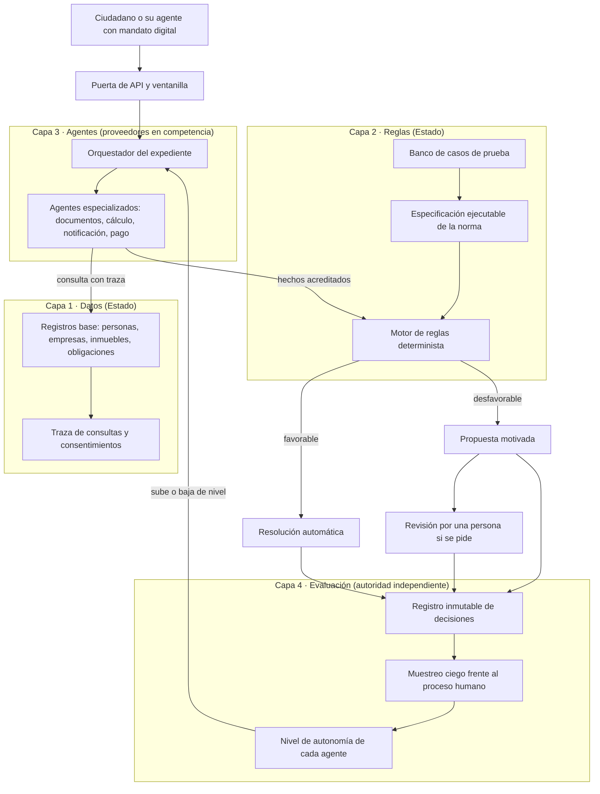

# 05 · Estado agéntico

*España Dinámica 2040 · Versión maximalista · noviembre de 2026*

**Base.** Parámetros: [00-parametros-de-diseno.md](00-parametros-de-diseno.md) (§9), que manda en caso de discrepancia. Origen: propuestas A1-A9 y F1 de la [revisión liberalizadora](../04-revision/01-revision-liberalizadora-ia.md). Contraste: [bloque 06](../02-bloques/06-funcion-publica-y-gasto.md), P3c. Plantilla y techo de gasto: [documento 04](04-estado-nucleo-y-gasto.md).

**Términos.** Un *sistema agéntico* (o agente) es un programa basado en un modelo de lenguaje que, dado un objetivo, planifica pasos, usa herramientas (consultar un registro, calcular, enviar una notificación) y conserva memoria del expediente. Un *motor de reglas* es un programa determinista que aplica una norma escrita como código: con los mismos datos da siempre el mismo resultado. "(propuesta de desarrollo)" marca lo que este documento añade a los parámetros.

---

## 1. Qué cambia frente a la versión contrastada

| Materia | Versión contrastada | Versión maximalista |
|---|---|---|
| Lugar de la IA | Una frase: "actuación administrativa automatizada con auditoría de algoritmos" (bloque 06, P3c) | Pieza central: arquitectura de cuatro capas y sustitución progresiva de tramitación |
| Normas | Se publican en texto | Toda norma con trámite se publica con especificación ejecutable y casos de prueba |
| Decisión | Humana con apoyo informático | Lo favorable, automático; lo desfavorable, propuesto por el agente y revisable por una persona |
| Ritmo | Sin calendario | Tres oleadas en 60 meses; la autonomía de cada agente depende de su tasa de error medida |
| Proveedores | Desarrollo propio o contrato de software | Mercado de agentes: contratos de 12-18 meses, pago por expediente y calidad, dos proveedores por procedimiento crítico |
| Relación con el ciudadano | Sede electrónica y ventanilla | Acceso por API con mandato digital, con la misma prioridad que la ventanilla |
| Plantilla | Reposición selectiva por perfiles | Reposición cero en gestión administrativa; el ahorro entra en el techo solo cuando la AIReF lo certifica |

---

## 2. Diseño

### 2.1 Arquitectura de cuatro capas

El Estado conserva los datos, las reglas y la evaluación, y compra la ejecución.



La decisión de diseño más importante está en el centro del diagrama: **el agente no aplica la norma; acredita los hechos y llama al motor de reglas, que es del Estado** (propuesta de desarrollo). El agente hace lo que los modelos de lenguaje hacen bien hoy: leer documentos no estructurados, consultar registros, pedir lo que falta y redactar. La regla la aplica un programa determinista, auditable y publicado. Así un error del agente es un error sobre un hecho, que se detecta comparando con la fuente, y no una interpretación libre de la norma.

### 2.2 Normas como código: un ejemplo trabajado

Toda norma con trámite se publica con su especificación ejecutable y su banco de casos de prueba, igual que hoy lleva memoria económica. La especificación es del Estado y se publica con licencia abierta. Una norma que no puede especificarse contiene discrecionalidad, y queda señalada como tal.

**Procedimiento: beca de matrícula universitaria.** Las cifras son ilustrativas, no las de la convocatoria vigente.

```text
NORMA  beca_matricula  versión 2028.1
HECHOS (fuente)
  residencia_legal        registro de población y de extranjería
  creditos_matriculados   registro universitario
  aprobado_curso_previo   registro universitario (% de créditos)
  miembros_unidad         registro de población + declaración
  renta_familiar          AEAT (renta computable del ejercicio n-2)
  patrimonio_catastral    Catastro
REGLAS
  R1  residencia_legal = sí
  R2  creditos_matriculados >= 60
  R3  aprobado_curso_previo >= 65 %   (no se aplica en primer curso)
  R4  renta_familiar <= UMBRAL[miembros_unidad]
        UMBRAL = {1: 15.000, 2: 25.000, 3: 33.000, 4: 39.000, +5: +4.000 por miembro}
  R5  patrimonio_catastral <= 100.000
RESULTADO
  concede  si R1..R5 se cumplen    importe = precio público de la matrícula
  deniega  si alguna falla         motivo = reglas fallidas y datos usados
HECHOS CON VALORACIÓN (siempre a una persona)
  V1  unidad familiar atípica (custodia compartida discutida, emancipación sin registro)
  V2  causa de fuerza mayor alegada sobre el rendimiento
```

**Casos de prueba** (extracto; el banco completo forma parte de la norma):

| Caso | Datos | Resultado esperado | Qué comprueba |
|---|---|---|---|
| T1 | 3 miembros, renta 33.000, 60 créditos, 70 % aprobado | Concede | Umbral exacto: la condición es "menor o igual" |
| T2 | 3 miembros, renta 33.001 | Deniega por R4 | Borde superior |
| T3 | Primer curso, sin curso previo | R3 no aplica; concede si R1, R2, R4 y R5 | Excepción de primer curso |
| T4 | Certificado de una universidad extranjera sin dato en el registro | Requerimiento de subsanación; nunca denegación | Hecho no acreditado no equivale a hecho negativo |
| T5 | Solicitante alega custodia compartida no registrada | Pasa a una persona (V1) | Valoración fuera del motor |
| T6 | 6 miembros, renta 42.000 | Concede (umbral 43.000) | Regla de miembros adicionales |

**Qué decide el agente:** reúne los hechos de los registros; lee el certificado extranjero y extrae los créditos, con indicación de su confianza; requiere lo que falta; llama al motor; notifica; a partir del nivel 3, firma la concesión. **Qué no decide:** el significado de una regla (es de la especificación), los hechos con valoración (V1 y V2), ni ningún caso que el banco de pruebas no cubra, que se escala y genera un caso nuevo para el banco.

### 2.3 Regla de asimetría

Lo favorable al ciudadano se resuelve de forma automática. Lo desfavorable (denegación, sanción, liquidación al alza) lo propone el agente con motivación regla por regla y los datos usados, y lo revisa una persona si el interesado lo pide, en un plazo legal de diez días hábiles (propuesta de desarrollo). La persona revisora no ve si la propuesta viene del agente o de otro revisor, para evitar el sesgo de aceptar lo que dice la máquina (propuesta de desarrollo). La asimetría tiene un coste: los errores favorables (conceder lo que no procede) los paga el erario. Por eso el muestreo de §2.5 mide los dos tipos de error por separado.

### 2.4 Niveles de autonomía: criterio de promoción y degradación

| Nivel | Qué hace el agente | Qué hace la persona |
|---|---|---|
| 1 · Asiste | Reúne datos y redacta | Decide todo |
| 2 · Propone | Propone la resolución completa | Valida cada expediente |
| 3 · Decide lo favorable | Resuelve lo favorable; propone lo desfavorable | Revisa lo desfavorable a petición y una muestra de lo favorable |
| 4 · Decide todo con muestreo | Resuelve todo | Revisa una muestra y todo lo recurrido |

Todo agente empieza en el nivel 1. El criterio exacto es este (propuesta de desarrollo):

- **Error de referencia.** Cada trimestre, la autoridad de evaluación mide la tasa de error del proceso humano en el mismo procedimiento, con el mismo diseño de muestra. Un error es una resolución distinta de la que acuerdan dos revisores expertos que no saben quién resolvió, con un tercero que decide si discrepan.
- **Muestra.** Al menos 750 expedientes por procedimiento y trimestre, estratificados por resultado. Con una tasa de error del 2 %, esa muestra la estima con un margen de ±1 punto al 95 % de confianza (1,96² × 0,02 × 0,98 / 0,01² ≈ 753).
- **Promoción.** Se sube un nivel cuando, durante dos trimestres seguidos, el extremo superior del intervalo de confianza del error del agente queda por debajo de la tasa de error humana, por separado en errores favorables y desfavorables, y ningún subgrupo (sexo, edad, nacionalidad, provincia, discapacidad) muestra un error significativamente mayor que el del proceso humano en ese mismo subgrupo.
- **Degradación automática.** Se baja un nivel, sin decisión política, si el extremo inferior del intervalo del error del agente supera la tasa humana en un mes cualquiera; si aparece una disparidad significativa en un subgrupo; o si se produce un incidente de seguridad. Un cambio de la norma devuelve el agente al nivel 2 hasta que supera el nuevo banco de pruebas al 100 % y una muestra de 750 expedientes.

Si la tecnología avanza despacio, los agentes se quedan en los niveles 1 y 2, el sistema sigue funcionando como apoyo a la tramitación humana y el dividendo de plantilla es menor. El diseño no depende de que lleguen los niveles 3 y 4.

### 2.5 Catálogo de oleadas

Entra antes lo reglado, de volumen alto y con datos ya estructurados en registros públicos. Los plazos se cuentan desde la ley de 2027.

| Oleada | Procedimiento | Por qué en esta oleada | Intervención humana que conserva |
|---|---|---|---|
| 1 (0-18 meses) | Prestación contributiva por desempleo | Reglada; volumen alto; datos en afiliación y cotizaciones | Revisión de denegaciones y de bajas por sanción |
| 1 | Ingreso mínimo vital | Reglado; datos de renta y padrón en registros | Revisión de denegaciones; unidad de convivencia atípica |
| 1 | Becas | Reglada; calendario anual; datos en AEAT y universidades | Hechos con valoración (§2.2) |
| 1 | Devoluciones tributarias | Reglada; volumen muy alto; datos ya en la AEAT | Inicio de comprobaciones |
| 1 | Inscripciones registrales regladas | Requisitos tasados; documentos normalizados | Calificación con dudas jurídicas |
| 1 | Declaración responsable de actividad y obra menor | Sin juicio previo: toma de razón y comprobación de seguro | Inspección posterior |
| 1 | Atención al ciudadano | Información, no decisión | Escalado a una persona a petición |
| 2 (18-36 meses) | Contratación pública: pliegos y criterios automáticos | Reglada en parte; exige plantillas normalizadas que hay que crear | Criterios sujetos a juicio de valor; adjudicación |
| 2 | Inspección dirigida por riesgo | Selección de objetivos con datos estructurados | Visita, acta y sanción |
| 2 | Tramitación judicial: reparto, señalamientos, borradores de resoluciones de trámite | Volumen alto; exige integrar sistemas de gestión procesal de varias administraciones | Toda resolución la firma el letrado o el juez; nunca sentencias |
| 2 | Gestión de personal: nóminas, permisos, licencias | Reglada; datos internos | Disciplina y evaluación |
| 3 (36-60 meses) | Gestión tributaria completa | Comprobaciones con interpretación; requiere niveles altos probados en la oleada 1 | Liquidaciones al alza a petición; inspección |
| 3 | Control continuo del gasto | Requiere contabilidad integrada de todas las administraciones | Reparos de la intervención |
| 3 | Planeamiento legible por máquina y licencia instantánea | Requiere traducir planes urbanísticos a especificación, municipio a municipio | Planeamiento y excepciones |

### 2.6 Mercado de agentes

| Elemento | Diseño |
|---|---|
| Contratos | De 12 a 18 meses por procedimiento, por acuerdo marco de la Ley 9/2017 con lotes por procedimiento |
| Pago | Por expediente resuelto, con un tramo variable ligado a la tasa de error medida; penalización por cada error desfavorable confirmado en revisión (propuesta de desarrollo) |
| Dos proveedores | Al menos dos por procedimiento crítico, con reparto del volumen y un mínimo del 20 % para el segundo, de modo que ambos estén siempre en producción (propuesta de desarrollo) |
| Portabilidad | Estado de los expedientes, registros e instrucciones en formatos abiertos; simulacro anual de salida en el que el segundo proveedor asume todo el volumen durante una semana (propuesta de desarrollo) |
| Propiedad pública | Especificaciones, instrucciones al modelo, bancos de prueba y evaluaciones son del Estado. El proveedor aporta el modelo y la operación |
| Datos | Prohibido usar datos de expedientes para entrenar modelos sin autorización expresa; datos sensibles solo en infraestructura bajo jurisdicción europea |

Sin dos proveedores en producción y portabilidad probada, el sistema sustituye un monopolio público por uno privado.

### 2.7 El agente del ciudadano

Todo trámite es accesible por API con la misma prioridad que la ventanilla. Gestorías, bancos y aplicaciones actúan con un mandato digital del interesado: una extensión del apoderamiento electrónico de la Ley 39/2015 (art. 6) con alcance por trámite, plazo y revocación inmediata (propuesta de desarrollo). El intermediario responde de lo que presenta, y el registro de la capa de datos traza cada consulta. La ventanilla presencial se mantiene mientras haya demanda y se mide su uso; desaparece por desuso, no por decreto.

### 2.8 Evaluación continua

| Pregunta | Respuesta |
|---|---|
| Quién | Una autoridad independiente con presidencia de mandato largo, separada de los ministerios que contratan y de los proveedores. Puede ubicarse en la Agencia Española de Supervisión de la IA, reforzando su independencia (propuesta de desarrollo) |
| Qué se mide | Error favorable y desfavorable; disparidad por subgrupo; tiempo de resolución; tasa de revisión pedida y de revisión estimada; recursos judiciales ganados por el ciudadano; coste por expediente; disponibilidad; incidentes |
| Con qué muestra | 750 expedientes por procedimiento y trimestre como mínimo, más muestras adicionales por subgrupo; parte del banco de evaluación se mantiene secreto para evitar que los proveedores ajusten sus agentes a la prueba |
| Qué se publica | Cuadro trimestral por procedimiento y proveedor, en datos abiertos; nivel de autonomía vigente; especificaciones y bancos de prueba públicos |

### 2.9 Plantilla y dividendo certificado

La reposición cero en gestión administrativa desde 2027 se apoya en la ola de jubilaciones: España es, tras Italia, el país de la OCDE más afectado en la próxima década ([diagnóstico §7.2](../01-investigacion/01-diagnostico-estructural.md)). Como orden de magnitud, cada 100.000 efectivos no repuestos equivalen a unos 0,3 puntos de PIB (no verificado).

El ahorro entra en el techo de gasto solo cuando la AIReF lo certifica. La certificación usa una fórmula pública (propuesta de desarrollo): plazas no repuestas en procedimientos con agentes en nivel 3 o superior, por su coste medio, menos el coste de los contratos de agentes, de la evaluación y de las revisiones humanas. El personal liberado de tramitación se reasigna con prioridad a justicia, inspección y revisión de propuestas desfavorables.

### 2.10 Marco jurídico

- **Art. 41 de la Ley 40/2015.** Ya permite la actuación administrativa automatizada, siempre que se haya establecido antes el órgano competente para definir las especificaciones, la programación, el mantenimiento, la supervisión y el control de calidad, y el órgano responsable a efectos de impugnación. La especificación ejecutable de §2.2 es ese acto previo.
- **Art. 22 del RGPD.** Prohíbe las decisiones basadas únicamente en tratamiento automatizado con efectos jurídicos, salvo que las autorice el derecho de la Unión o del Estado miembro con medidas adecuadas. Cada ley sectorial autoriza de forma expresa la resolución automatizada y fija las garantías: explicación, revisión por una persona y posibilidad de recurso. La regla de asimetría las cumple.
- **Reglamento europeo de IA (Reglamento (UE) 2024/1689).** Las prohibiciones de prácticas inaceptables se aplican desde febrero de 2025 y las obligaciones de transparencia del art. 50 desde el 2 de agosto de 2026. El Reglamento ómnibus digital sobre IA (Reglamento (UE) 2026/1744, en vigor desde el 27 de julio de 2026) aplazó las obligaciones de los sistemas de alto riesgo del anexo III, entre los que están los usados por autoridades públicas para evaluar el derecho a prestaciones y servicios públicos esenciales, hasta el 2 de diciembre de 2027, y las del anexo I hasta el 2 de agosto de 2028. El aplazamiento no suprime obligaciones ([Lewis Silkin](https://www.lewissilkin.com/insights/2026/07/27/the-digital-omnibus-on-ai-enters-into-force-today-102nedo); [AI Acto](https://www.aiacto.eu/en/blog/digital-omnibus-ai-act-report-2027); fuentes secundarias, texto del Diario Oficial no consultado). La primera oleada empieza antes de esa fecha: se cumplen desde el primer día la supervisión humana, el registro de actividad, la evaluación de impacto en derechos fundamentales y la inscripción en la base de datos europea (propuesta de desarrollo). El motor de reglas determinista probablemente no es un "sistema de IA" en el sentido del Reglamento; el agente que acredita hechos sí lo es (interpretación propia; requiere dictamen).
- **Transparencia del código.** El Tribunal Supremo (sentencia 1119/2025, de 11 de septiembre, caso BOSCO del bono social eléctrico) reconoció el acceso de la Fundación Civio al código fuente de una aplicación administrativa, con alcance limitado al caso ([Cuatrecasas](https://www.cuatrecasas.com/es/spain/propiedad-intelectual/art/caso-bosco-acceso-codigo-fuente-aplicaciones-publicas)). Aquí la publicación es la regla.

### 2.11 Seguridad y soberanía de datos

La capa de datos es el activo más valioso del país y se queda en el núcleo estatal, bajo el Esquema Nacional de Seguridad. Los agentes no copian registros: consultan por API con permiso por trámite, y cada consulta queda trazada. Los datos sensibles se procesan en infraestructura bajo jurisdicción europea. Todo documento que aporta el ciudadano se trata como dato y nunca como instrucción, para protegerse de la inyección de instrucciones (textos ocultos que intentan dar órdenes al modelo); los agentes no pueden ejecutar pagos fuera de los que calcula el motor de reglas. Cada procedimiento tiene un interruptor que lo devuelve al nivel 1 en minutos, y ejercicios de ataque controlados antes de cada subida de nivel (propuesta de desarrollo).

### 2.12 Qué pueden y qué no pueden hacer hoy los sistemas agénticos

**Demostrado a noviembre de 2026** (en uso amplio, con supervisión): extraer datos de documentos, clasificar solicitudes, resumir, redactar borradores y responder consultas con fuentes documentales; usar herramientas en flujos acotados y repetitivos; escribir y revisar código. La automatización con reglas deterministas sin IA está probada desde hace años en la Administración española, por ejemplo en la gestión tributaria.

**Límites conocidos hoy:** fiabilidad que cae cuando la tarea es larga o tiene muchos pasos; errores presentados con seguridad ("alucinaciones"); resultados no siempre idénticos ante la misma entrada; vulnerabilidad a la inyección de instrucciones; mala calibración de su propia confianza. Por eso el diseño deja la regla al motor determinista y exige muestreo.

**Lo que se espera para 2027-2031, sin darlo por hecho:** tareas más largas con fiabilidad suficiente para el nivel 4 en procedimientos reglados, interpretación fiable de normas con conceptos indeterminados y traducción asistida de normas a especificación. Ninguna de estas capacidades está demostrada a escala administrativa. La tercera oleada depende de ellas; las dos primeras, no.

---

## 3. Transición 2027-2036

| Periodo | Hitos |
|---|---|
| 2027 | Ley del Estado agéntico (normas como código, asimetría, niveles, autoridad de evaluación, mandato digital). Primeras especificaciones. Primeros contratos de la oleada 1, en nivel 1 |
| 2 de diciembre de 2027 | Obligaciones de alto riesgo del Reglamento de IA, ya cumplidas por diseño |
| 2028 | Oleada 1 en niveles 2-3 donde lo permita la evaluación. Inicio de la oleada 2 a mediados de año |
| 2029-2030 | Oleada 2. Primera renovación de contratos con cambio de proveedor donde la calidad lo aconseje |
| 2030-2032 | Oleada 3, condicionada a resultados |
| 2033-2036 | Régimen permanente: toda norma nueva con especificación; revisión del catálogo cada dos años |

---

## 4. Quién gana y quién pierde

| Grupo | Efecto |
|---|---|
| Solicitantes de prestaciones, becas y devoluciones | Ganan rapidez en lo favorable; asumen el riesgo de errores sistemáticos, mitigado por revisión y muestreo |
| Empresas y autónomos | Ganan con licencias y registros inmediatos |
| Personal de gestión administrativa | Sin despidos, pero sin reposición; reasignación a revisión, justicia e inspección |
| Proveedores tecnológicos | Ganan un mercado; pierden el bloqueo por propiedad de las especificaciones |
| Gestorías e intermediarios | Ganan si se convierten en agentes del ciudadano; pierden la tramitación manual |
| Personas con baja competencia digital | Riesgo de exclusión; la ventanilla persiste mientras se use |

---

## 5. Riesgos, evidencia y mitigación

| Riesgo | Evidencia | Mitigación que no desmonta el diseño | Indicador de alerta |
|---|---|---|---|
| Errores a escala | Robodebt (Australia): el promedio automático de ingresos generó deudas ilegales a más de 400.000 personas entre 2015 y 2019, según la Comisión Real de 2023 ([Law Society Journal](https://lsj.com.au/articles/crude-cruel-and-unlawful-robodebt-royal-commission-findings/)). Países Bajos: acusaciones de fraude erróneas en ayudas de guardería a miles de familias; el Gobierno dimitió en enero de 2021 ([CNBC](https://www.cnbc.com/2021/01/15/dutch-government-resigns-after-childcare-benefits-scandal-.html)) | Regla en motor público con banco de pruebas; asimetría; hecho no acreditado nunca es denegación; degradación automática | Tasa de revisiones estimadas; disparidad por subgrupo |
| Dependencia de proveedores | Dos o tres empresas concentran los modelos de frontera ([revisión, A9](../04-revision/01-revision-liberalizadora-ia.md)) | Dos proveedores en producción; propiedad pública de instrucciones; simulacro anual de salida | Cuota del primer proveedor; resultado del simulacro |
| Ahorro menor del previsto | La digitalización estonia se cita con un ahorro del 2 % del PIB que es una estimación gubernamental antigua sin auditar ([evidencia §3.3](../01-investigacion/02-evidencia-internacional.md)); la externalización da ahorros modestos ([§5.4](../01-investigacion/02-evidencia-internacional.md)) | Dividendo solo certificado; el modelo supone efecto cero en productividad [SUP] | Dividendo certificado frente a reposición no cubierta |
| Pérdida de capacidad interna | Nueva Zelanda: fragmentación y pérdida de capacidad estratégica tras contratar la gestión ([evidencia §5.1](../01-investigacion/02-evidencia-internacional.md)) | Equipo público que escribe especificaciones y evalúa; los revisores humanos siguen resolviendo una muestra | Vacantes en el equipo de especificación |
| Ataque a la capa de datos | Activo de máximo valor | Datos en el núcleo; acceso por trámite; Esquema Nacional de Seguridad; interruptor | Incidentes; accesos anómalos |
| Legitimidad | Recortar la revisión humana sería ilegal (RGPD, Reglamento de IA) | Asimetría y explicación regla por regla | Recursos judiciales ganados por ciudadanos |

---

## 6. Qué queda sin resolver

1. **El volumen por procedimiento.** El proyecto no tiene datos de expedientes por procedimiento; el orden de las oleadas se basa en criterios cualitativos.
2. **La tasa de error humana de referencia.** No se mide hoy; su primera medición es condición para cualquier promoción.
3. **La clasificación jurídica fina** de cada procedimiento en el Reglamento de IA y la ubicación institucional de la autoridad de evaluación requieren dictamen.
4. **Las comunidades autónomas.** Gestionan buena parte de los procedimientos de la oleada 1 (IMV en parte, becas propias, licencias municipales); su adhesión no está garantizada.
5. **Las capacidades futuras.** La tercera oleada depende de capacidades no demostradas. El efecto sobre la productividad agregada vale cero en el caso central: véase el escenario E del modelo (`modelo/RESULTADOS.md`).
